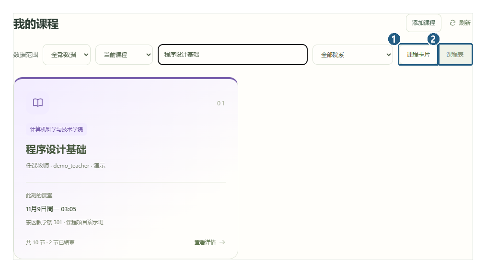
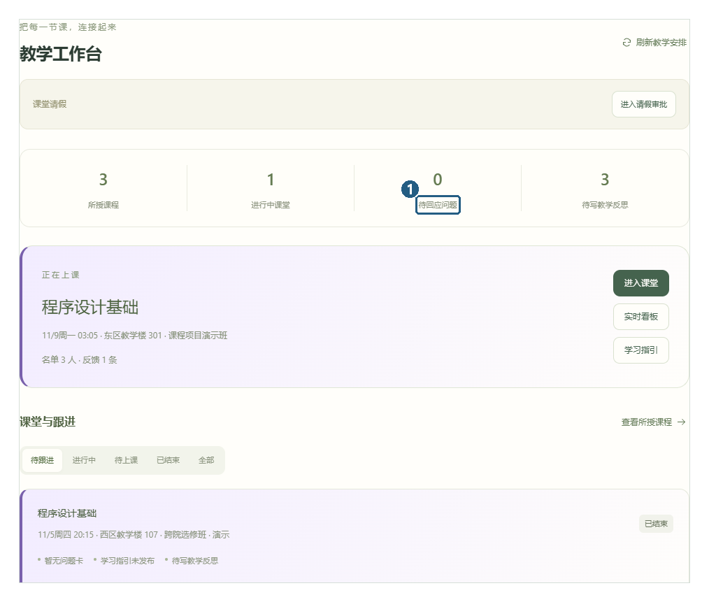
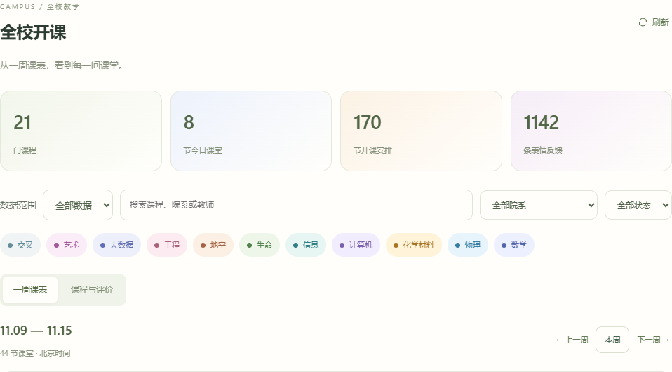

# HappyClass 课堂情绪检查器

让课堂感受被看见，让师生沟通有回应。支持学生、教师、管理员三种身份，覆盖课堂反馈、学习记录、教学跟进和校园课程维护。

## 📖 [点击阅读：完整功能使用说明 · 真实截图版](docs/manual/README.md)

**35 个功能场景 · 56 幅带编号框的配图 · 入口、步骤、结果完整说明。点击上方标题即可在 GitHub 直接阅读，不用下载 Word。**

[学生功能](docs/manual/README.md#student) · [教师功能](docs/manual/README.md#teacher) · [管理员功能](docs/manual/README.md#admin) · [下载 Word 版（49 页）](docs/manual/课堂情绪检查器功能使用说明_真实截图版_20261109.docx)

[安装与组员交接](docs/GETTING_STARTED.md) · [三人演示路线](docs/manual/README.md#walkthrough) · [常见问题](docs/manual/README.md#faq)

## 界面实拍

### 学生：从已加入的课程开始

搜索课程、查看详情，在课程卡片与彩色周课表之间切换；日常直接选择正在进行或刚结束的课堂提交感受和评价。



[查看课程操作步骤](docs/manual/README.md#scene-04) · [查看课堂评价](docs/manual/README.md#scene-08) · [查看可点击的日期回顾](docs/manual/README.md#scene-13)

### 教师：把学生反馈接入教学流程

在工作台定位当前课堂和待办，回应匿名问题、发布学习指引、审批请假，再查看统计和教学反思。



[查看教学工作台](docs/manual/README.md#scene-21) · [查看统计与导出](docs/manual/README.md#scene-27)

### 管理员：全校开课与院系配色

同一院系使用统一颜色，支持全校课表、课程评价、院系课程维护及成员管理。



[查看全校课表](docs/manual/README.md#scene-30) · [查看院系维护](docs/manual/README.md#scene-31) · [查看账号与名单管理](docs/manual/README.md#scene-33)

截图来自同一应用的独立测试环境，人物与排课为合成演示内容，不代表学校官方课表。完整手册包含每张图的编号说明和实际操作结果。

## 已有功能

| 身份 | 主要功能 | 图文入口 |
| --- | --- | --- |
| 学生 | 课程与周课表、加入课程、表情反馈、四项评价、匿名提问、学习指引 | [课程与课堂](docs/manual/README.md#scene-04) |
| 学生个人空间 | 私人笔记、查询与 CSV 导出、日期回顾、资料与头像裁剪、好友学伴、留言墙、请假、站内消息 | [笔记与回顾](docs/manual/README.md#scene-11) · [学伴与留言](docs/manual/README.md#scene-16) |
| 教师 | 课堂安排、课程邀请、问题回应、指引草稿与发布、请假审批、实时看板、统计导出、评价汇总、教学反思 | [教师完整流程](docs/manual/README.md#teacher) |
| 管理员 | 全校开课与评价、院系配色、课程归档恢复、教师分配、账号创建、课堂名单、演示数据筛选 | [管理员完整流程](docs/manual/README.md#admin) |
| 通用 | 登录与账号安全、角色权限、消息已读与跳转、本地演示身份切换 | [首次使用](docs/manual/README.md#common) |

加入码只在添加课程时使用；个人笔记和回顾由本人查看；好友学伴是普通学生之间的关系。表情反馈条数、参与人数和四项评分份数分别统计。

## 本地启动

已验证 Windows PowerShell、Python 3.13、Node.js 22.12 及以上。后端使用 FastAPI，前端使用 Vue 3 / Vite，数据库为 SQLite，无需另装数据库服务。

```powershell
git clone https://github.com/kiloheromyday/happyClass.git
cd happyClass
powershell -ExecutionPolicy Bypass -File .\scripts\setup.ps1
.\.venv\Scripts\python.exe -m backend.manage create-user --username admin --role ADMIN
powershell -ExecutionPolicy Bypass -File .\scripts\start.ps1
```

创建管理员时，按提示自行设置密码。启动后访问 **<http://127.0.0.1:18080/>**。

新克隆的仓库不包含原电脑数据库、账号和历史数据。需要丰富课表和可切换的演示身份，请按 [本地演示配置步骤](docs/GETTING_STARTED.md#3-建立可切换角色的本地演示) 创建账号、生成数据并启动演示模式。完整安装、开发、备份和测试命令均在 [安装与组员交接](docs/GETTING_STARTED.md)。

## 交接与后续工作

选做扩展版本 **0.22.0**，原交接版本 **0.21.1**；图文手册与界面完善日期 **2026-11-09**。已补充管理员账号草稿保护、统计筛选后的重新查询提示和导出限制，并统一“表情反馈”数量名称，详见 [本次完善](docs/manual/README.md#walkthrough)。

可选 AI 已验证服务就绪及 JPEG 请求链路；**物理摄像头预览、连续识别、设备释放和另一台电脑部署仍待实机验收**。手动反馈及其他业务不依赖 AI 服务。当前数据库实现为 SQLite，MySQL / PostgreSQL 适配和公网部署尚未完成。Docker Compose 已完成本机容器运行验证；GitHub Actions 已在小组仓库通过[扩展分支检查](https://github.com/kiloheromyday/happyClass/actions/runs/42764849798)，不代表公网或其他电脑部署已验收。

## 指导书 2.3 选做扩展

- **匿名与聚合模式**：按课堂配置标准、匿名或仅聚合展示，覆盖反馈历史、看板与 CSV 导出。
- **异步 AI 结果队列**：Redis Streams 处理标签结果，提供签名校验、幂等入库、重投恢复、限次重试及管理员任务状态入口；独立采集命令支持 `--delivery queue`。
- **MCP 工具服务**：官方 MCP SDK 提供 stdio 模型状态、显式 JPEG 分析工具和能力资源，不自动访问摄像头或写入课堂数据库。
- **Docker Compose 与 CI**：多阶段镜像、一键启动脚本及自动化测试与容器检查流程。

安装、页面入口、API 与故障恢复见 [选做扩展说明](docs/OPTIONAL_EXTENSIONS.md)。贡献范围及原有 AI 模型的复用边界见 [Lccccc679 工作记录](docs/CONTRIBUTION_Lccccc679.md)。扩展未训练新的情绪模型，不能据此宣称识别准确率提高。

| 资料 | 用途 |
| --- | --- |
| [安装与组员交接](docs/GETTING_STARTED.md) | 环境、演示数据、开发命令、测试、三人分工 |
| [需求](docs/REQUIREMENTS.md) · [设计与 ER 图](docs/DESIGN.md) · [数据库脚本](database/schema.sql) | 报告与代码结构依据 |
| [部署说明](docs/DEPLOYMENT.md) · [数据库要求核对](docs/DATABASE_REQUIREMENTS.md) | 新电脑运行及选型说明 |
| [全面测试报告](docs/COMPREHENSIVE_TEST_20261104.md) · [交接复验](docs/HANDOFF_20261107.md) | 已执行的检查及时间范围 |
| [浏览器验收](docs/BROWSER_ACCEPTANCE.md) · [最终清单](docs/FINAL_CHECKLIST.md) · [摄像头记录](docs/CAMERA_TEST_20261104.md) | 后续验收 |
| [三人分工](docs/TEAM_HANDOFF.md) · [演示与报告](docs/DEMO_AND_REPORT.md) | 组员接手与答辩准备 |
