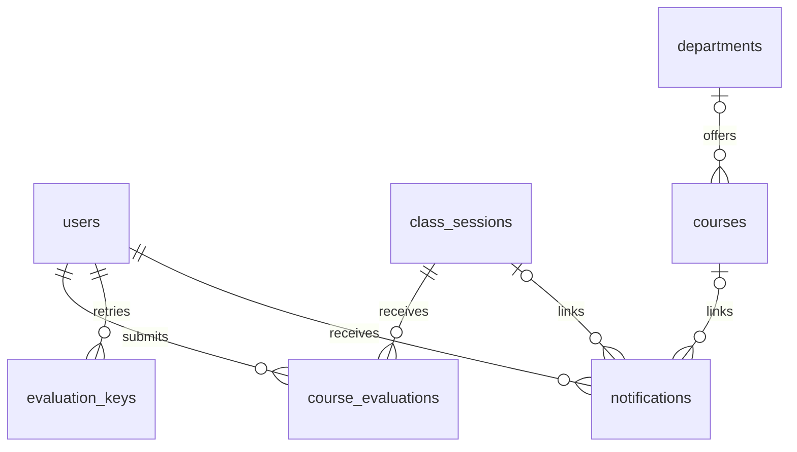
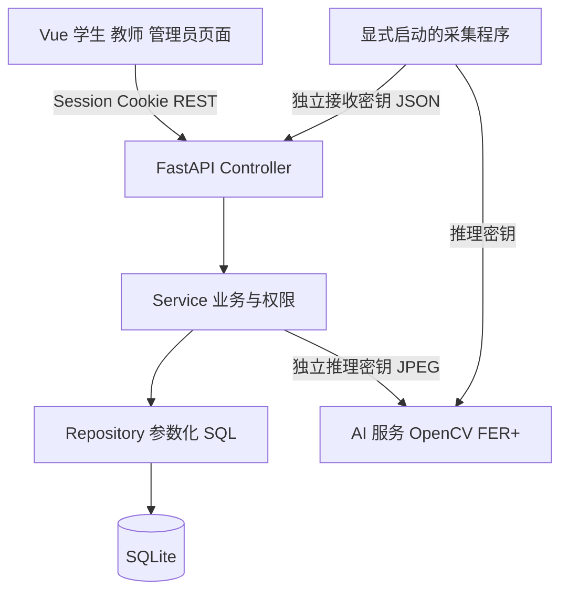
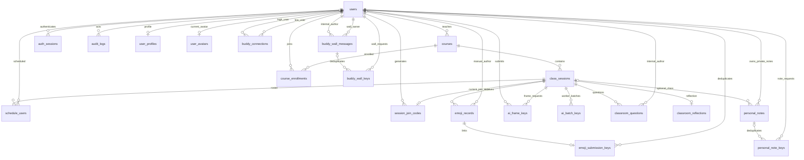

# 课堂情绪检查器系统设计

## 0.21.1 重试与页面时序修复

course_creation_keys 以 user_id/request_id 唯一记录课程和标准化内容摘要，课程、请求键及审计在同一事务内创建；新客户端保留同内容的 UUID，旧客户端可省略。管理员创建课堂也支持可选 UUID，与教师共用 teaching_session_keys。已成功课堂请求先检查当前任课权限，再读取原成功结果，最后才为新请求检查归档和时间，防止归档误报与原教师越权。

学生评价入口和课堂状态按当前时钟与明确起止时间更新，结束后 30 分钟截止；后端仍在提交时校验。统计刷新捕获课堂/数据范围并取消过时请求；消息轮询用读取时的修订号隔离较新的已读操作。评价总数减少时自动回到有效页码。

## 0.21.0 课程评价、消息与维护

course_evaluations 以 session_id/student_id 唯一保存四项评分、建议、版本和演示标记；evaluation_keys 保存请求内容摘要与结果，实现修改和网络重试分离。教师汇总使用字段白名单，不返回学生身份、个人提交时间或请求键。匿名 CSV 同口径并处理公式字符。

notifications 按 user_id/event_key 唯一保存业务通知、目标课堂/课程和 read_at。业务事件在原事务内插入通知，读取/已读只按当前收件人限制；通知不复制私密请假原因、回复或问题作者。课程转交后目标页面重新鉴权。removed_departments 保存已删除内置院系的编号，防止重启自动补回。

courses.archived/version 和 departments.version 通过兼容迁移加入。维护比较版本，课程归档不删记录；禁止新增课堂与通过码新加入，不取消已安排课堂。院系颜色由统一查询字段返回，课程/课表不各自维护副本。

演示范围由各实体明确的 is_demo 标记决定，汇总、趋势、明细和导出共享条件。课程筛选按课程标记，记录筛选按记录标记，不将演示账号的实际手动反馈自动当作合成记录。详情见 COURSE_EVALUATIONS_AND_MESSAGES.md。

系统用统一 REST API 连接角色化浏览器页面、应用服务和独立 AI 推理服务。目标是在本机运行与演示完整的人工反馈和匿名 AI 反馈流程，同时使权限、统计口径和原始媒体处理规则可检查。

## 架构与职责

浏览器 View 用 Vue 渲染函数展示表单、图表和状态；组件状态与交互相当于 ViewModel，api.js 封装统一网络访问。应用 Controller 负责路由、输入和依赖，Service 处理课堂时间、课程归属、筛选与幂等，Repository 负责事务和数据查询。这里将修改版 MVC 落实为角色页面与后端三层协作，而不是只按文件名宣称采用 MVC。

AI 服务不直接访问业务数据库，只检测人脸、分类并返回概率。浏览器路径由业务后端代理图片；独立采集路径由采集程序先调用推理，再向业务后端提交匿名结果。两类机器凭据分开，浏览器不接触它们。后端保证 source 和匿名用户字段，不接受调用者指定学生身份。

## 数据关系

schema.sql 为可执行的字段、外键、索引和枚举定义。用户包含角色、状态和密码哈希；课程关联任课教师；课堂保存时段、班级与教室；名单为课堂与学生的唯一关联。emoji_records 保存表情、时间、来源、置信度与设备标记。MANUAL 必须关联用户，AI 必须有置信度且业务层固定匿名。人工请求键、网页帧键与采集批次键分别处理重复提交，避免网络重试增加计数。

user_profiles 保存可选昵称、简介、兴趣、专业、年级、学习目标、偏好方式和头像配色；buddy_connections 以一对排序用户 ID 唯一保存学生学伴关系，待处理申请需接收方明确同意。资料和好友不会赋予他人读取个人情绪或邮箱的权限。学习资料支持多关键词与组合筛选，结果分页，详见 PROFILE_AND_BUDDIES.md。

## 核心流程和约束

学生提交先检查名单与课堂状态，在同一事务中保存记录和请求键。教师查询在数据库查询层限制本人课程，明确查询他人课堂返回拒绝。管理员更新名单先验证所有学生，再整体替换，任一非法对象会回滚。

网页 AI 路径先验证角色和课堂归属，再限制 JPEG 大小并请求模型，最后再次校验课堂状态并事务保存。独立结果接收只认可专用 Bearer 令牌，严格校验批次、设备、带时区的采集时间和最多 12 个结果；新批次仅限进行中的课堂，采集时间需属于课堂且在最近 5 分钟内。已成功批次的原样重试返回原结果，即使课堂之后结束，也不会重新入库。

统计区间为开始包含、结束排除，时间统一转 UTC；图表按 UTC 分桶补零，显示时说明时区。AI 采样次数和手动反馈次数均为记录数；只有人工记录可去重为反馈学生数，匿名 AI 不推算人数。CSV 与统计沿用相同筛选和权限范围。

## 安全与运行限制

密码采用 PBKDF2-SHA256 600000 次、独立随机盐。随机会话令牌只把摘要存入数据库，浏览器 Cookie 为 HttpOnly、SameSite Strict，默认 8 小时。改密使全部旧会话失效。网页写入检查来源与专用请求头；公开学生注册不接受角色提权。参数化 SQL、字段白名单、CSV 公式转义和数据库约束共同保护输入与输出。

默认只绑定本机 HTTP。远程部署需 HTTPS、安全 Cookie、明确 Origin 和网络隔离；采集程序拒绝向远程明文 HTTP 地址发送机器密钥。模型不做身份匹配，内存处理帧后丢弃。SQLite 适合单机课程演示，不承诺多节点高并发能力。

原始接口定义由运行中的 `/openapi.json` 生成，打包时另外导出到 docs/api。数据库采用幂等初始化新增辅助表；跨数据库迁移、业务表破坏性升级和正式迁移工具尚未实现。

## 0.9.0 课堂互动扩展

classroom_questions 内部关联作者供权限、请求去重及限流使用，对课堂参与者返回显式匿名字段白名单。classroom_reflections 每课堂一条，回应和反思均使用版本号防止覆盖其他编辑者的更新。读取问题需名单内学生或有课堂权限的教师/管理员，小结仅供教师/管理员。

小结统计和导出在单一数据库读事务内获取快照。按课堂时间中点分段，开始包含、结束排除；时段外记录单独说明。反思为教师手动填写，不从情绪推断教学效果或心理状态。详见 CLASSROOM_ENGAGEMENT.md。

## 0.10.0 个人空间

personal_notes 属于学生本人，可选关联课堂；笔记读写、选项、搜索、导出和回顾均限制所有者。教师和管理员也不能通过应用接口读取。personal_note_keys 保存新建请求摘要，笔记实际删除后保留空引用，防止旧创建请求重试重新生成笔记。修改与删除校验版本。课堂选项来自当前名单、本人手动反馈或本人已有笔记，不扩大对其他课堂内容的读取权限。

个人回顾只统计本人手动反馈及未删除笔记；近 7/30/90 天为滚动 UTC 区间，可选课堂条件同时作用于概览、分布、趋势、课堂与近期笔记。待回顾数统计当前课堂范围的全部时间。导出在单一读快照内取得数据，文件标明当次滚动区间。前端草稿仅在内存，保存前阻止工作台切换并注册浏览器离开提醒。详见 PERSONAL_NOTES.md。

## 0.11.0 学伴留言墙

buddy_wall_messages 分别关联墙主和内部作者。墙访问限定墙主及当前已确认学伴，匿名与可点击来源两种方式在发布时固定。列表、创建、更新用白名单排除身份；独立来源接口仅在作者发布时允许公开且当前有访问权限时，返回公开学习资料。作者可编辑正文，作者/墙主可删除，均受版本控制。buddy_wall_keys 记录幂等摘要，删除后引用置空；本人发出记录支持关系解除后的作者清理，不开放墙读取权限。接口、受众与匿名边界见 BUDDY_WALL.md。

## 0.12.0 加入码

session_join_codes 每课堂保存一条当前有效设置，关联课堂与生成者。教师归属、有效期、课堂状态、版本和请求去重均由后端校验；加入事务先检查码、时段和 500 人上限，再写入唯一名单关联。更换或停用码不删除名单。原始码仅供授权教师/管理员读取，审计不记原始码；数据库访问者仍可读码。详见 JOIN_CODES.md。

## 0.13.0 课程加入与日常评价

course_enrollments 保存学生已加入的课程。首次升级从原名单回填，不改变旧课堂名单。添加课程通过仍由课堂托管的有效码进入，安排该课程所有未结束课堂；今后新建课堂自动安排有效课程成员。名单移除仅影响该节，不视为退出课程。新课程成员与多节名单在单一事务内保存，任一目标满员整体回滚，最多每节 500 人。日常评价没有加入码入口，只展示已加入课程和所选可评价课堂。

人工反馈允许从课堂开始到结束后 30 分钟，截止时刻不包含，使用同一个服务器时间判断并入库。状态仍为 ENDED，通过 can_feedback 和 feedback_closes_at 表达课后窗口，避免扩大 AI 与问题卡权限。统计仍按实际提交时间记录；课后反馈计入总计，并在教师小结中列为课堂时段以外，不混入前后半节对比。

## 0.14.0 日期详情

个人回顾趋势复用 TrendChart 的可选交互模式，其他图表保留原展示行为。日期详情请求携带总览查询的起止时间与课堂条件，服务器校验带时区、正时段、至多 90 天及日期相交，按 UTC 日边界取交集；同一读事务取得本人手动反馈、分布及当天新建笔记，反馈/笔记各 12 条独立分页。列表字段白名单不包含其他用户或 AI。前端单独取消日期请求，并在筛选变化与离开时清理，避免旧详情覆盖新选择。无需新增表或迁移旧数据。

## 0.18.0 本地演示开发者模式

服务端仅在 EMOJI_DEMO_MODE=1 且实际请求 peer/Host 为回环地址时开放演示入口；默认关闭。浏览器主动 enable 后获得独立、8 小时、HttpOnly/SameSite Strict 的能力 Cookie，数据库仅保存哈希；切换和成员管理均逐次检查能力与本地条件，写入还验证来源。固定账号白名单和角色/状态校验防止任意用户免密码登录，普通登录不会授予本能力。

成员管理不支持管理员、角色转换和硬删除；固定 demo 账号保护。昵称与邮箱修改比较预期值检测过时资料，保留其他档案字段；停用和密码重设原子撤销目标普通会话。所有操作记录不含密码的演示审计。新表 demo_access_sessions 为辅助能力表，无原账号迁移。

App 同步 demo 状态并在 AuthPanel/Workspace 插槽展示 DeveloperPanel。账号切换返回真实 public_user，旧浏览器普通会话被撤销；Workspace 以 user.id 为 key 重挂载，防止残留角色工作台。跨工作台草稿状态与成员表单脏状态共同限制身份切换、普通登录和退出；能力续开不会更改身份，可保留成员草稿。

## 0.17.0 教师与学生的教学闭环

TeachingPanel 从角色受限的 overview 获取所授课堂和匿名问题状态、是否有教学反思、是否发布指引；不查询学生私人笔记。教师课堂采用反馈概览、问题回应、学习指引、小结、名单五个视图，共享 Workspace 的课堂/课程导航上下文。课堂、看板、统计间跳转保留范围，取消过时读取防止旧课堂覆盖新选择。

classroom_guides 在同一行分别保存教师草稿与发布快照。SAVE 不触碰发布快照，PUBLISH 在事务内替换，UNPUBLISH 清除公开字段并保留草稿。学生 API 使用显式白名单，只返回 published；每次读取仍验证实际课堂名单。写入验证所属课程、版本与来源，记录审计。教学反思仍只在原教师接口提供。

teaching_session_keys 以 user_id/request_id 防止网络重试创建重复课堂，并用标准化内容哈希拒绝同键不同载荷。创建新课堂与课程成员继承、请求键、审计均在同一写事务；管理员旧接口保持兼容。前端问题回应、反思、指引和课堂安排汇总未保存状态，禁止跨功能或工作台丢失编辑。

## 0.16.0 课程详情

课程列表使用独立 CoursesPanel 展示可点击卡片；详情读取 GET /api/courses/{course_id}，单个读事务内汇总当前有权访问的课堂。学生白名单字段仅携带本人手动反馈与笔记计数；教师仅看到自己所授课堂的聚合记录和名单人数。保留课程成员与课堂名单的权限区别。

Workspace 支持带 courseId/sessionId/view 的导航，仍先检查草稿。ClassroomPanel 初始化指定课堂并展开全部范围；PersonalNotesPanel 初始化笔记课堂筛选或 90 天回顾，新建笔记预关联当前筛选。两个页面均可返回原课程。课程详情读取在切换/卸载时取消，加入码组件限定于本课程课堂。

## 0.15.0 个人主页

user_avatars 每账号一条经过校验、裁剪与重新编码的当前 JPEG 图片，以内容摘要生成受控图片地址，不采用用户文件名或外部 URL。头像与资料分开保存；替换旧图片后旧摘要地址不可读。角色化概览在单一读事务取得，仅给本人。学生头像属于公开学习资料，仅登录学生/本人/管理员可读，教师头像只允许本人/管理员；匿名留言列表不附作者头像，明确公开来源时才返回头像地址。详见 PROFILE_HOME.md。
