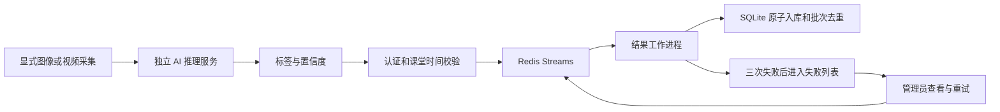

# 指导书 2.3 选做扩展

普通启动按项目 README 走。要试 Lccccc679 加的隐私设置、队列、MCP 或 Compose，可以按下面的步骤来。

## 功能与入口

| 功能 | 使用入口 | 怎么用 |
| --- | --- | --- |
| 标准、匿名、聚合模式 | 所有角色工作台的“反馈隐私” | 学生只读，任课教师及管理员可设置 |
| 隐私版本冲突保护 | 保存隐私设置 | 已有反馈后不能降低保护等级 |
| 匿名历史与导出 | 课堂历史、实时看板、统计 CSV | 隐藏账号、用户 ID 和设备标识，不删除内部归属 |
| 聚合模式与专用 CSV | “反馈隐私 → 导出本节聚合 CSV” | 只输出情绪、来源和记录数，无逐条记录或个人标识 |
| AI 异步接收 | POST /api/ai/queued-results | 独立 AI 接收凭据，返回 202 表示接收，不表示入库完成 |
| 结果工作进程 | python -m ai_service.worker | Redis Streams 消费组、认领超时投递、最多 3 次处理尝试 |
| 重复保护与签名 | 自动执行 | 设备/批次唯一键，HMAC 校验；入库和业务去重在同一 SQLite 事务 |
| 队列监控与失败重放 | 管理员“反馈隐私 → AI 异步处理” | 显示积压、心跳、失败代码；只有管理员可重试 |
| AI MCP 工具 | python -m ai_service.mcp_server | stdio 协议，模型状态与查模型状态、分析 JPEG 两个工具 |
| Compose 部署 | scripts/start-extensions.ps1 | 独立数据库卷、Redis AOF、健康检查、可选 AI 服务 |
| 自动检查 | .github/workflows/ci.yml | 推送、PR 或手动触发测试、构建、真实 Redis 测试及容器健康检查 |

## 匿名和聚合的含义

从侧栏进「反馈隐私」，任课教师和管理员可以按课设置。默认是标准模式。选「匿名展示」后，教师和管理员在明细、看板和 CSV 里看不到账号、用户 ID 和设备标识。选「仅聚合展示」后，这些入口只显示分类统计。导出的范围含聚合课堂时，明细 CSV 会返回 `AGGREGATE_ONLY`，可以改用「导出本节聚合 CSV」。

学生仍能在自己的历史里查到手动反馈，因此数据库里会保留账号归属。AI 结果没有学生账号。课堂有记录之后，模式只能从标准改成匿名或聚合，或者从匿名改成聚合。两个人同时编辑时，后保存的一方会看到 409，页面会保留草稿。

## 异步结果处理流程



队列里传的是批次、课堂、设备、采集时间和分类结果，原图不入队。服务端会记下收到结果的时间并签名。后台用这个时间检查课堂和采样，所以结果排队到下课以后也能正常处理。

后台用 `XREADGROUP` 取结果，入库后用 `XACK` 确认。如果还没确认就中断，另一个进程可以用 `XAUTOCLAIM` 接手。已经存过的批次由 `ai_batch_keys` 拦下来。

默认容量为 10000 个等待或处理中的消息，可通过 EMOJI_QUEUE_CAPACITY 调整。队列满或 Redis 连不上时返回 503。恢复后可以用原批次重试。普通失败最多尝试三次，永久输入错误直接进入失败列表。管理员可将保留期内的失败任务重新排队。任务元数据保留七天；失败索引最多保存最近 1000 条，页面显示最近 20 条中的当前失败任务。Redis 开启 AOF everysec，主机突然断电仍存在约一秒持久化窗口。

### 本机启用

先装好普通运行环境，再装队列所需的依赖。

```powershell
.\.venv\Scripts\python.exe -m pip install -r requirements-extensions.txt
$env:EMOJI_REDIS_URL = 'redis://127.0.0.1:6379/0'
.\.venv\Scripts\python.exe -m ai_service.worker
```

需要 Redis 6.2 或以上版本，也可以用下方的 Compose。主服务和后台进程要连同一套 SQLite、Redis，并读取同一份 AI 接收密钥。换密钥前先让队列处理完，旧任务的签名用新密钥过不了。

在另一终端将已有采集命令追加 `--delivery queue`：

```powershell
.\.venv\Scripts\python.exe -m ai_service.capture --image YOUR_IMAGE.jpg --session-id SESSION_ID --device-id lab-camera --delivery queue
```

网页相机仍用同步识别。上面的独立采集命令加了 `--delivery queue` 才会走队列。要用摄像头采集，需要自己选择 `--camera` 或在网页开启。

## MCP 工具服务

MCP 客户端用 stdio 启动 Python 进程。配置里填项目所在路径和 AI 地址即可。

| 名称 | 类型 | 行为 |
| --- | --- | --- |
| model_status | 工具 | 返回模型服务就绪情况，不返回服务地址或密钥 |
| analyze_emotion | 工具 | 输入 base64 JPEG，返回通过分数门槛的情绪分类 |
| happyclass://ai/capabilities | 资源 | 可以查图片大小上限和分类列表 |

先按原 README 准备并启动 AI 服务，再由支持 MCP 的客户端使用配置：

```json
{
  "mcpServers": {
    "happyclass-emotion": {
      "command": "ABSOLUTE_PROJECT_PATH/.venv/Scripts/python.exe",
      "args": ["-m", "ai_service.mcp_server"],
      "cwd": "ABSOLUTE_PROJECT_PATH",
      "env": {"EMOJI_AI_URL": "http://127.0.0.1:18081"}
    }
  }
}
```

路径需替换为实际项目位置，Linux 的解释器为 `.venv/bin/python`。密钥默认从本机 data/ai-service.token 读取，也支持 EMOJI_AI_TOKEN_FILE。不要将机器密钥写进公开的客户端配置示例。

上传的是 JPEG 的 base64 内容，去掉 data-URL 前缀，解码后最多 1 MB。工具只接图片内容，文件路径或 URL 都不能直接传。图片会发给配置好的 AI 服务分析。

## Docker Compose

准备已安装并运行的 Docker Desktop，使用 Linux 容器。在项目根目录执行：

```powershell
powershell -File .\scripts\start-extensions.ps1 -WithAI
```

首次运行会生成两份密钥，存在本机并挂载到需要的容器。已有密钥会沿用。AI 镜像构建时下载模型并检查 SHA256。密钥和数据库都留在本机。

默认网址为 http://127.0.0.1:18090，避免与原本的 18080 本机服务冲突；EMOJI_WEB_PORT 可指定端口。只监听回环地址。首次创建自己的管理员：

```powershell
docker compose exec web python -m backend.manage create-user --username admin --role ADMIN
```

基础启动省略 `-WithAI`，包括网页、Redis 和结果工作进程；带参数再启动真实模型服务。AI、Redis 和工作进程不对宿主机发布端口。AI 服务不直接挂载业务数据库，MCP 不挂载数据库。

Docker 中的 MCP 供客户端以 stdio 调用：

```text
docker compose --profile ai run --rm -T mcp
```

先启动 AI 服务，再把 MCP 客户端的工作目录设成项目根目录。MCP 进程由客户端启动。

常用维护命令：

```powershell
docker compose ps
docker compose logs --tail 100 web worker redis
docker compose --profile ai stop
docker compose --profile ai up -d --wait
docker compose --profile ai down
```

普通 down 保留数据库和队列卷。删除卷会永久清除其中的数据，不是常规重启步骤。不要把本机 data/classroom.db 复制进镜像；若需迁移数据，先停服务并一致性备份，再按实际部署流程迁移。

## CI 和验证

推送代码或开 PR 会跑两组检查。`tests` 构建前端，运行 Python、JavaScript 和真实 Redis 用例。`containers` 用临时密钥启动 Compose，检查网页、队列和 AI 服务，结束后清理临时卷。[主分支运行记录](https://github.com/kiloheromyday/happyClass/actions/runs/43003503852)

本机检查命令：

```powershell
.\.venv\Scripts\python.exe -m pip install -r requirements-extensions-test.txt
.\.venv\Scripts\python.exe -m pytest -q tests/test_privacy_modes.py tests/test_result_queue.py tests/test_mcp_extension.py
node tests/test_privacy_interactions.cjs
```

本机没有设 `EMOJI_TEST_REDIS_URL` 时，真实 Redis 用例会跳过。其他队列测试用 fakeredis，可以直接跑。
