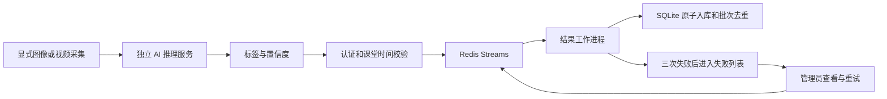

# 指导书 2.3 选做扩展

本分支围绕匿名与聚合展示、异步 AI 结果入库、MCP 推理工具、Compose 和 CI 实现选做功能。由 Lccccc679 认领，使用 AI 辅助实现和检查；个人验收、讲解和远程提交以实际记录为准。原有同步识别与本机启动方式继续可用。

## 功能与入口

| 功能 | 使用入口 | 实现边界 |
| --- | --- | --- |
| 标准、匿名、聚合模式 | 所有角色工作台的“反馈隐私” | 学生只读，任课教师及管理员可设置 |
| 隐私版本冲突保护 | 保存隐私设置 | 已有反馈后不能降低保护等级 |
| 匿名历史与导出 | 课堂历史、实时看板、统计 CSV | 隐藏账号、用户 ID 和设备标识，不删除内部归属 |
| 聚合模式与专用 CSV | “反馈隐私 → 导出本节聚合 CSV” | 只输出情绪、来源和记录数，无逐条记录或个人标识 |
| AI 异步接收 | POST /api/ai/queued-results | 独立 AI 接收凭据，返回 202 表示接收，不表示入库完成 |
| 结果工作进程 | python -m ai_service.worker | Redis Streams 消费组、认领超时投递、最多 3 次处理尝试 |
| 重复保护与签名 | 自动执行 | 设备/批次唯一键，HMAC 校验；入库和业务去重在同一 SQLite 事务 |
| 队列监控与失败重放 | 管理员“反馈隐私 → AI 异步处理” | 显示积压、心跳、失败代码；只有管理员可重试 |
| AI MCP 工具 | python -m ai_service.mcp_server | stdio 协议，模型状态与显式 JPEG 分类两个工具 |
| Compose 部署 | scripts/start-extensions.ps1 | 独立数据库卷、Redis AOF、健康检查、可选 AI 服务 |
| 自动检查 | .github/workflows/ci.yml | 推送、PR 或手动触发测试、构建、真实 Redis 测试及容器健康检查 |

## 匿名和聚合的含义

默认 STANDARD 保留已有行为。ANONYMOUS 在教师和管理员表情明细、看板最新记录与 CSV 中隐藏用户 ID、用户名和设备标识。AGGREGATE 在这些入口停止提供逐条表情反馈，只提供现有统计与按情绪、来源分组的聚合 CSV。混合范围里只要存在聚合模式课堂的反馈，明细 CSV 导出就会返回 AGGREGATE_ONLY，不能借跨课堂筛选绕过限制。历史列表分页和总数也排除这些逐条记录。

人工反馈仍保留内部账号归属，以支持学生本人历史、权限校验和防重复；AI 结果不关联学生身份。匿名展示不等于不可逆匿名，也不是对数据库管理员的保密承诺。聚合统计仍显示记录次数和时间趋势，小样本或外部线索仍可能产生推断风险；没有宣称实现差分隐私或 k 匿名。课程名单、请假及其他业务的可见性遵循原有权限，不由表情隐私设置重写。

设置有版本号，过期修改返回 409 并保留前端草稿。课堂已存在任何表情记录时，只能 STANDARD → ANONYMOUS → AGGREGATE 提高保护等级，不能重新显示旧记录身份。未保存的草稿阻止导航、退出及演示角色切换。

## 异步结果处理流程



消息只包含批次、课堂、设备标识、采集时间和情绪概率，不包含原始图像或视频。服务器记录首次接收时间并签名。工作进程以已认证的接收时间验证课堂和采样有效性，避免正常排队后因下课或超过五分钟而错误丢弃结果。客户端不能提交或覆盖接收时间。

Streams 使用 XREADGROUP 消费、XACK 确认、XAUTOCLAIM 恢复长期未确认消息。数据库提交后、队列确认前崩溃时，重投由已有 ai_batch_keys 防止重复入库。因此投递语义是至少一次，业务写入通过事务实现幂等；不宣称所有组件间具备分布式恰好一次语义。

默认容量为 10000 个等待或处理中的消息，可通过 EMOJI_QUEUE_CAPACITY 调整。满载和 Redis 不可用时返回 503，不谎报成功。客户端沿用原批次重试。普通失败最多尝试三次，永久输入错误直接进入失败列表。管理员可将保留期内的失败任务重新排队。任务元数据保留七天；失败索引最多保存最近 1000 条，页面显示最近 20 条中的当前失败任务。Redis 开启 AOF everysec，主机突然断电仍存在约一秒持久化窗口。

### 本机启用

先完成普通环境安装，然后安装选做依赖：

```powershell
.\.venv\Scripts\python.exe -m pip install -r requirements-extensions.txt
$env:EMOJI_REDIS_URL = 'redis://127.0.0.1:6379/0'
.\.venv\Scripts\python.exe -m ai_service.worker
```

需要一个实际可达的 Redis 6.2 或以上服务；推荐使用下面的 Compose。主服务和工作进程必须连接同一数据库和 Redis，并读取同一独立 AI 接收密钥。不要同时对两个不同数据库消费同一个消费组。更换接收密钥前先排空队列；未排空时旧签名不会被新密钥接受。

在另一终端将已有采集命令追加 `--delivery queue`：

```powershell
.\.venv\Scripts\python.exe -m ai_service.capture --image YOUR_IMAGE.jpg --session-id SESSION_ID --device-id lab-camera --delivery queue
```

摄像头只能由使用者主动选择 `--camera` 或在网页中主动开启。此扩展不自动启动相机。网页原来的 AI 帧识别仍走同步路径，独立采集程序可显式选择异步路径。

## MCP 工具服务

服务使用官方 Python MCP SDK 的 stdio 传输，由调用客户端启动进程，不另开无需认证的 HTTP 端口。

| 名称 | 类型 | 行为 |
| --- | --- | --- |
| model_status | 工具 | 返回模型服务就绪情况，不返回服务地址或密钥 |
| analyze_emotion | 工具 | 分析调用者明确提供的 base64 JPEG，返回阈值过滤后的七类情绪结果 |
| happyclass://ai/capabilities | 资源 | 描述输入上限、类别、能力边界和模型局限 |

先按原 README 准备并启动 AI 服务，再由支持 MCP 的客户端使用配置：

```json
{
  "mcpServers": {
    "happyclass-emotion": {
      "command": "ABSOLUTE_PROJECT_PATH/.venv/Scripts/python.exe",
      "args": ["-m", "ai_service.mcp_server"],
      "cwd": "ABSOLUTE_PROJECT_PATH",
      "env": {"EMOJI_AI_URL": "http://127.0.0.1:18081"}
    }
  }
}
```

路径需替换为实际项目位置，Linux 的解释器为 `.venv/bin/python`。密钥默认从本机 data/ai-service.token 读取，也支持 EMOJI_AI_TOKEN_FILE。不要将机器密钥写进公开的客户端配置示例。

输入为不带 data-URL 前缀的标准 base64 JPEG，解码后不超过 1 MB。工具不接受文件路径或用户指定 URL，不读取任意本机文件，不匹配身份、不访问业务数据库、不触发摄像头。工具会把明确提供的图像发给配置好的推理服务进行内存推理；“只读”不表示没有网络请求。模型输出不能用于心理诊断。

## Docker Compose

准备已安装并运行的 Docker Desktop，使用 Linux 容器。在项目根目录执行：

```powershell
powershell -File .\scripts\start-extensions.ps1 -WithAI
```

脚本生成两份独立随机机器密钥，已有文件不覆盖，通过 Compose secrets 按服务挂载。它们与数据库、依赖、模型权重一起排除在 Git 和构建上下文之外。镜像以非 root 用户运行，模型只在 AI 镜像构建中下载并校验 SHA256，不在镜像中生成或烘焙服务密钥。

默认网址为 http://127.0.0.1:18090，避免与原本的 18080 本机服务冲突；EMOJI_WEB_PORT 可指定端口。只监听回环地址。首次创建自己的管理员：

```powershell
docker compose exec web python -m backend.manage create-user --username admin --role ADMIN
```

基础启动省略 `-WithAI`，包括网页、Redis 和结果工作进程；带参数再启动真实模型服务。AI、Redis 和工作进程不对宿主机发布端口。AI 服务不直接挂载业务数据库，MCP 不挂载数据库。

Docker 中的 MCP 供客户端以 stdio 调用：

```text
docker compose --profile ai run --rm -T mcp
```

客户端的工作目录应为项目根目录；需要先构建并启动 AI 服务。不要把 MCP 进程当作一个需要后台长期打开的网页服务。

常用维护命令：

```powershell
docker compose ps
docker compose logs --tail 100 web worker redis
docker compose --profile ai stop
docker compose --profile ai up -d --wait
docker compose --profile ai down
```

普通 down 保留数据库和队列卷。删除卷会永久清除其中的数据，不是常规重启步骤。不要把本机 data/classroom.db 复制进镜像；若需迁移数据，先停服务并一致性备份，再按实际部署流程迁移。

## CI 和验证

CI 仅有 contents:read 权限，不自动发布镜像、修改仓库、合并 PR 或部署到外部服务器。测试任务安装依赖、构建前端、运行 Python 与前端组件检查，并利用独立 Redis 15 号库验证实际消费和崩溃恢复。容器任务创建临时密钥，检查 Compose 配置、构建并启动基础服务和真实 AI 服务，执行健康检查后清理本次临时卷。

本机检查命令：

```powershell
.\.venv\Scripts\python.exe -m pip install -r requirements-extensions-test.txt
.\.venv\Scripts\python.exe -m pytest -q tests/test_privacy_modes.py tests/test_result_queue.py tests/test_mcp_extension.py
node tests/test_privacy_interactions.cjs
```

未配置 EMOJI_TEST_REDIS_URL 时，真实 Redis 测试会明确跳过，其余队列测试使用 fakeredis。Docker 不可用时只能记录配置和代码检查，不能把它写成容器部署成功。流水线文件存在也不等于 GitHub Actions 已执行通过，以远程运行记录为准。
