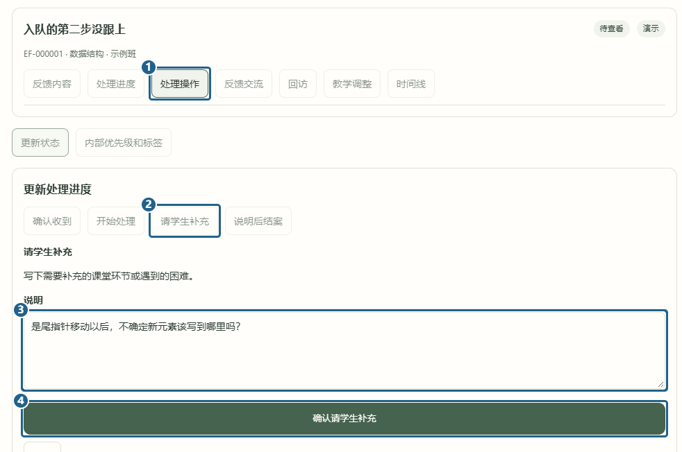

# 教师查看并追问

[返回已有功能](../../../README.md#已有功能)

老师打开「情绪反馈处理中心 → 反馈列表」，点进「入队的第二步没跟上」。按图点 **[1] 处理操作**、**[2] 请学生补充**，在 **[3] 说明** 里写出想问的问题，再点 **[4] 确认请学生补充**。

反馈会变成「待学生补充」。学生可以在详情的「反馈交流」里答复。答复后状态回到「处理中」，老师可以继续回复，或在处理后发回访。

[上一篇 学生提交反馈](submit-feedback.md) · [下一篇 发回访与结案](review-feedback.md)
