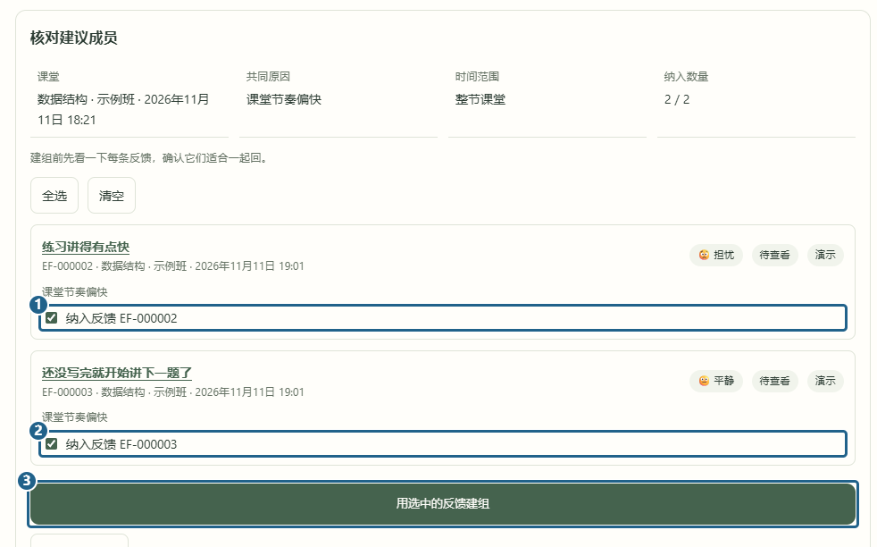
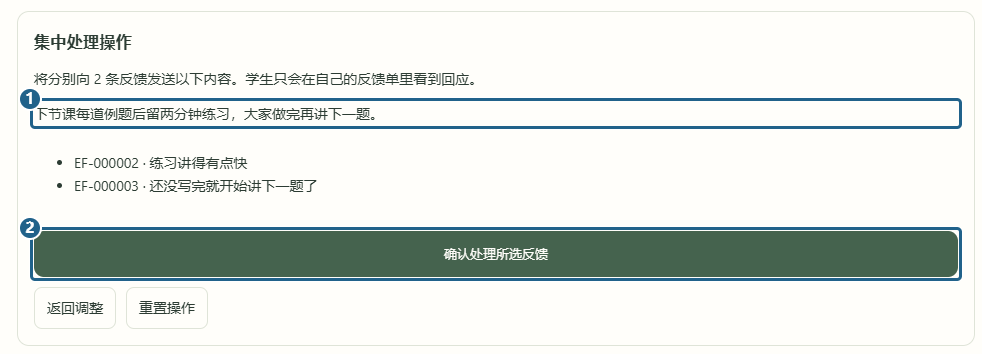

# 分组和批量回应

[返回已有功能](../../../README.md#已有功能)

同一节课有几条相似反馈时，老师可以在「反馈列表」勾选后建组，也可以进「集中处理 → 查看分组建议」。打开一组建议后，先读 **[1] [2] 两条反馈**，留下适合一起处理的，再点 **[3] 用选中的反馈建组**。给组起个名字并保存。

进组后选择「统一回应」，勾选要回复的反馈，填好内容并点「预览批量操作」。检查 **[1] 回应内容** 和收件列表，再点 **[2] 确认处理所选反馈**。示例中两条都成功处理，每位学生只在自己的反馈里看到同一条回复。

[上一篇 发回访与结案](review-feedback.md) · [下一篇 情绪回放](replay-emotion.md)
