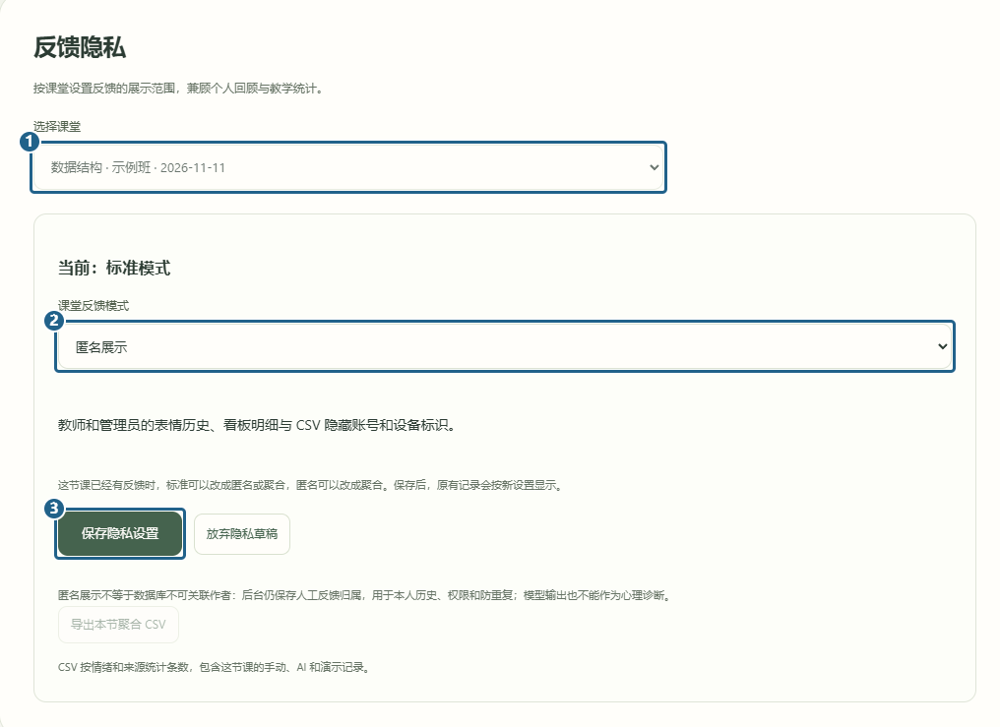

# 反馈隐私

[返回已有功能](../../../README.md#已有功能)

任课老师或管理员打开「反馈隐私」。先 **[1] 选课堂**，再从 **[2] 课堂反馈模式** 选「匿名展示」或「仅聚合展示」，点 **[3] 保存隐私设置**。

保存后可看上方的「当前」模式。匿名展示会隐藏表情明细里的账号和设备标识，聚合模式只显示统计。学生还能看自己的记录。课堂已有表情反馈时，只能从标准改成匿名或聚合，或从匿名改成聚合。

AI 队列、MCP 和 Compose 的启动命令另见[选做扩展说明](../../OPTIONAL_EXTENSIONS.md)。

[上一篇 情绪洞察](teaching-insights.md)
