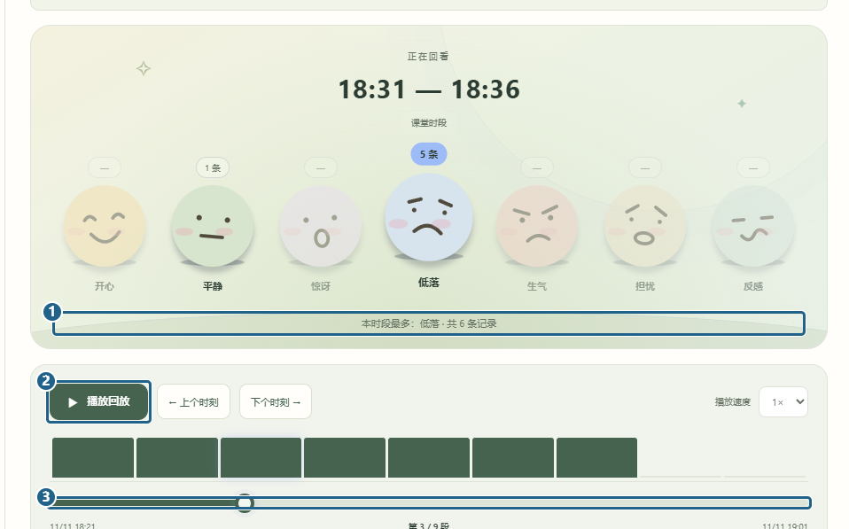
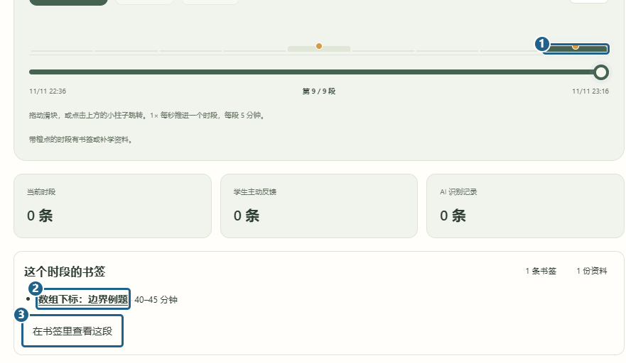

# 情绪回放

[返回已有功能](../../../README.md#已有功能)

教师或管理员从左侧打开「情绪回放」，选一节课。可以从上方筛选记录来源，也可以改成每五分钟或十分钟一段。

图中 **[1]** 是这一段的反馈条数和最多的类别，**[2]** 是播放按钮，**[3]** 是时间轴。点柱子或拖滑块就能跳到那一段。想跳过没记录的时段，用「上个时刻」和「下个时刻」。

## 在回放里找课堂卡点

时间轴上 **[1] 带橙点的柱子** 表示这段有书签或补学资料。点开后，下方会显示书签条数和已发布的资料。点 **[2] 资料标题** 可以打开原文，点 **[3] 在书签里查看这段** 可以回到同一节课的时段统计。

[上一篇 分组和批量回应](batch-feedback.md) · [下一篇 情绪洞察](teaching-insights.md)
