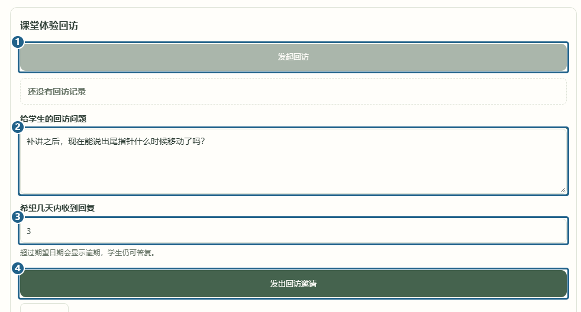
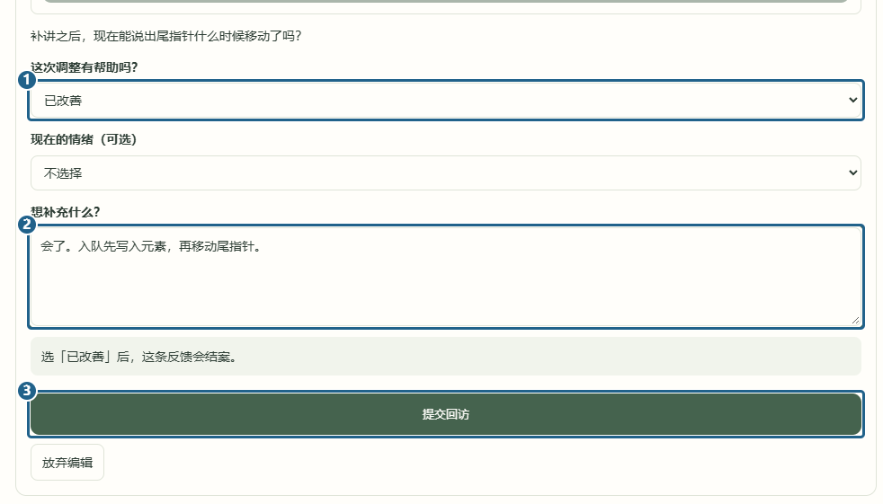
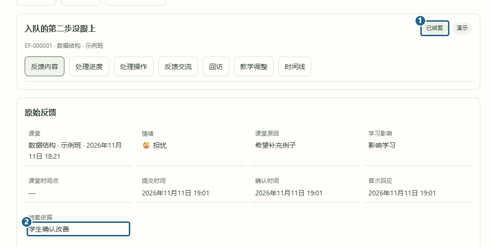

# 发回访与结案

[返回已有功能](../../../README.md#已有功能)

老师补讲后，打开反馈的「回访」页签。点 **[1] 发起回访**，填 **[2] 想问学生的问题**，选 **[3] 期望答复天数**，最后点 **[4] 发出回访邀请**。

学生从「回访日程」点「填写回访」，进入后点「填写这轮回访」。在 **[1] 帮助程度** 选「已改善」「部分改善」或「仍未改善」，也可以在 **[2] 补充说明** 写现在会做哪一步，再点 **[3] 提交回访**。

选「已改善」后，反馈显示 **[1] 已结案**，详情里的依据为 **[2] 学生确认改善**。另外两个选项会让反馈回到「处理中」。还没答复且已逾期的回访，老师可以到「回访日程」发站内提醒。

[上一篇 教师查看并追问](ask-student.md) · [下一篇 分组和批量回应](batch-feedback.md)
