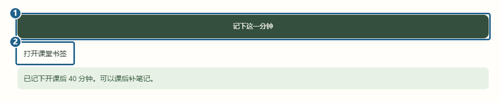
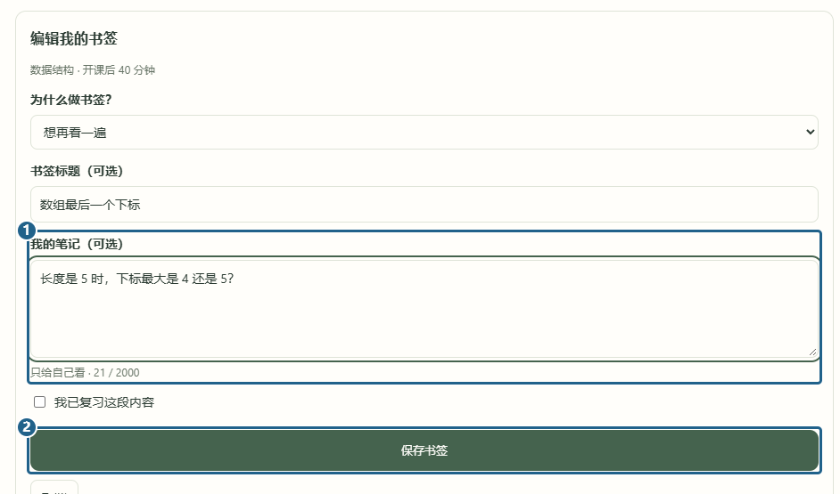
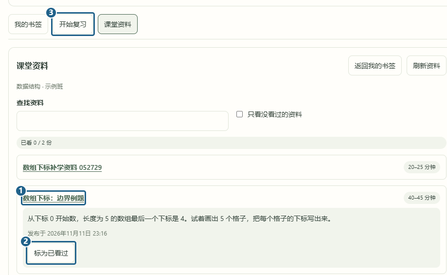

# 学生记书签与复习

[返回已有功能](../../../README.md#已有功能)

上课时哪一步没跟上，可以在「我的课堂」点 **[1] 记下这一分钟**。页面会提示记在开课后第几分钟。想补一句话，点 **[2] 打开课堂书签**。

在「我的书签」找到刚才那条，点「编辑」。可以给它起个标题，在 **[1] 我的笔记** 里写下具体疑问，再点 **[2] 保存书签**。这段笔记只有自己能看。上课时忘了点，下课后七天内还可以点「补记一个时间点」，选当时的分钟。

老师给这段发了资料后，书签下面会出现资料标题。点标题会打开「课堂资料」里的 **[1] 对应资料**，看完点 **[2] 标为已看过**。接着到 **[3] 开始复习**，对已经弄懂的书签点「这条已复习」。

[教师查看卡点与发布资料](teacher-bookmarks.md)
