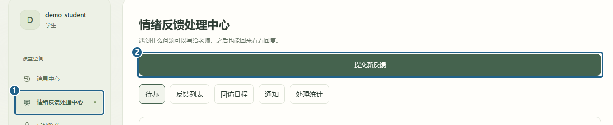
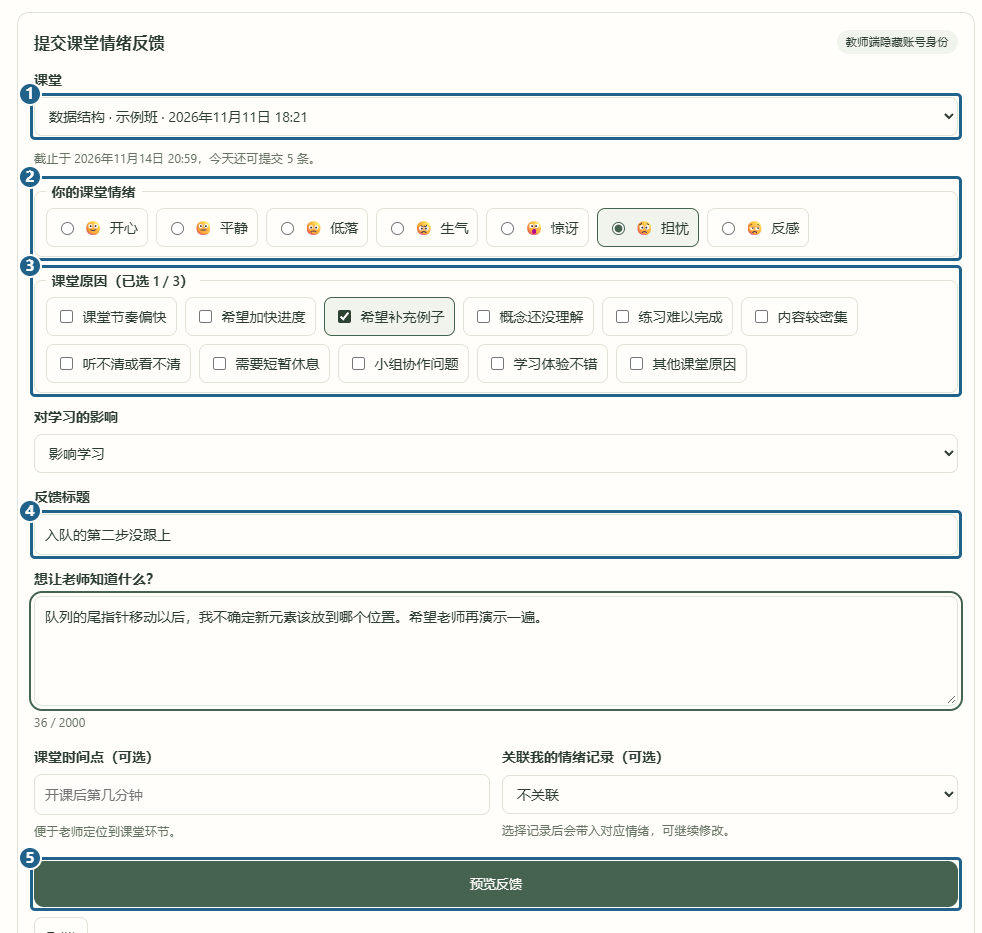
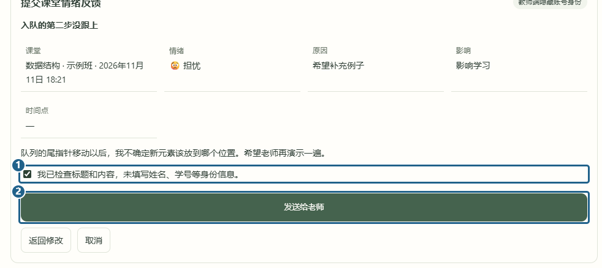

# 学生提交反馈

[返回已有功能](../../../README.md#已有功能)

学生登录后，点左侧 **[1] 情绪反馈处理中心**，再点 **[2] 提交新反馈**。也可以从「我的课堂」打开一节课，点「给老师写条反馈」。

表单里 **[1] 选一节课**、**[2] 选表情**、**[3] 勾原因**。可以选一到三个原因。**[4] 写个标题**，下面再写具体卡在哪一步。截图中的学生想让老师再讲一次队列入队，填好后点 **[5] 预览反馈**。

在预览里 **[1] 勾选已检查身份信息**，然后点 **[2] 发送给老师**。老师能看见你写的内容，页面会隐藏学生账号。正文里也别写姓名或学号。

发出后会打开这条反馈。以后从「反馈列表」也能找到它。

[下一篇 教师查看并追问](ask-student.md)
