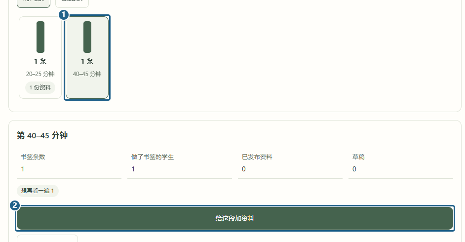
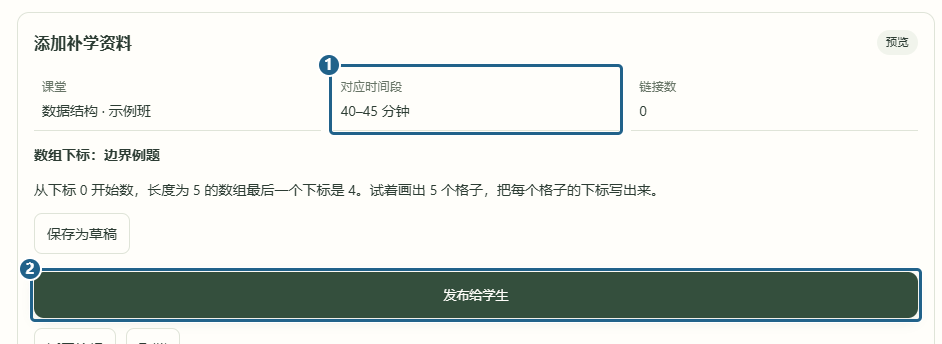

# 教师查看卡点与发布资料

[返回已有功能](../../../README.md#已有功能)

教师从侧栏进「课堂卡点书签」，选课程和课堂。在「时段统计」点 **[1] 一个时段**，下方会显示这一段的书签数、学生人数和原因分布。比如发现数组下标那几分钟有人卡住，可以点 **[2] 给这段加资料**。统计页只显示汇总数据，学生的私人笔记留在自己的书签里。

填写标题和讲解，需要时也可以加链接。点「预览资料」，核对 **[1] 对应时间段**，再点 **[2] 发布给学生**。暂时没写完就点「保存为草稿」。发布后的资料会出现在学生的「课堂资料」和对应时段的书签下面。

发布后可在「阅读汇总」查看有多少人点了「已看过」。修改资料后，看过当前版和只看过旧版的人数会分开显示。

[学生记书签与复习](student-bookmarks.md) · [在情绪回放里找课堂卡点](replay-emotion.md#在回放里找课堂卡点)
