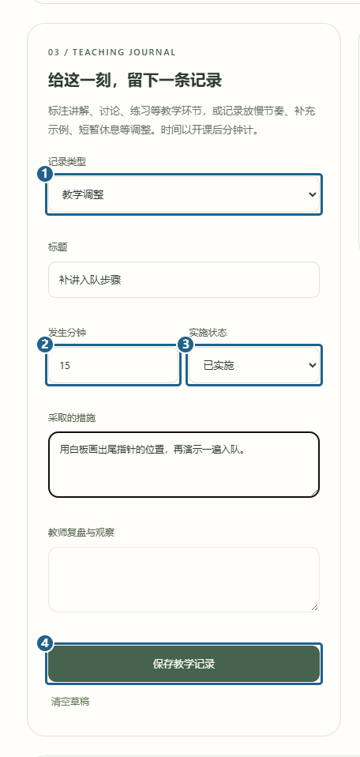
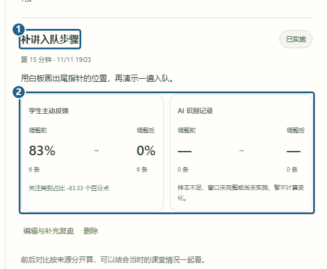

# 情绪洞察

[返回已有功能](../../../README.md#已有功能)

教师或管理员从左侧进「情绪洞察」选课。用演示课堂时，把「数据范围」改成「仅演示数据」。在关注时段点「记录一次教学调整」，也可以直接到下方的教学记录表单。

把 **[1] 记录类型** 设成「教学调整」，填写标题和做法。**[2] 发生分钟** 从开课算起，已经做过的调整在 **[3] 实施状态** 选「已实施」，然后点 **[4] 保存教学记录**。

保存后，右侧能看到 **[1] 补讲入队步骤**。**[2]** 里手动反馈和 AI 记录分开显示。截图中手动反馈前后各有六条，AI 那栏没有样本。可以在页面上方改对比窗口。比例有变化时，还要结合当时的教学情况一起看。

[上一篇 情绪回放](replay-emotion.md) · [下一篇 反馈隐私](feedback-privacy.md)
