# HappyClass 功能使用说明 · 真实截图版

**直接在本页阅读，无需下载 Word。** 35 个功能场景、56 幅配图（53 张不同截图），包含真实页面、蓝色编号框、操作步骤、结果与注意事项。

[返回项目首页](../../README.md) · [安装与组员交接](../GETTING_STARTED.md) · [下载 Word 完整版（49 页）](课堂情绪检查器功能使用说明_真实截图版_20261109.docx)

## 按身份快速阅读

| 阅读入口 | 适合完成的任务 |
| --- | --- |
| [通用：登录、注册、演示切换](#common) | 首次进入和账号安全 |
| [学生：课程、评价与个人空间](#student) | 课堂反馈、笔记回顾、头像、学伴、请假与消息 |
| [教师：教学工作台](#teacher) | 排课、回应问题、发布指引、审批、统计及反思 |
| [管理员：全校课程与成员](#admin) | 全校课表、院系配色、课程、名单及演示维护 |
| [三人联合演示与本次完善](#walkthrough) | 组员演示、修复记录和验收边界 |
| [常见问题](#faq) | 空白数据、加入码、权限和设备问题 |

展开全部 35 个功能入口

- [01 登录并确认身份](#scene-01)
- [02 学生注册与账号安全](#scene-02)
- [03 开启本地演示和切换身份](#scene-03)
- [04 浏览课程卡片与一周课表](#scene-04)
- [05 使用加入码添加课程](#scene-05)
- [06 提交一次课堂感受](#scene-06)
- [07 查看个人情绪历史](#scene-07)
- [08 填写四项课程评价](#scene-08)
- [09 匿名提问并查看回应](#scene-09)
- [10 阅读已发布学习指引](#scene-10)
- [11 保存课堂笔记与个人随记](#scene-11)
- [12 组合查找和导出笔记](#scene-12)
- [13 点击日期节点回顾一天](#scene-13)
- [14 编辑主页和学习偏好](#scene-14)
- [15 上传裁剪头像](#scene-15)
- [16 按多种属性查找学伴](#scene-16)
- [17 申请和管理好友学伴](#scene-17)
- [18 发布匿名或可查看来源的留言](#scene-18)
- [19 按具体课堂提交请假](#scene-19)
- [20 从消息中心返回处理入口](#scene-20)
- [21 从教学工作台定位待办](#scene-21)
- [22 为已有课程安排新课堂](#scene-22)
- [23 邀请学生加入课程](#scene-23)
- [24 回应问题并标记解决](#scene-24)
- [25 区分备课草稿和正式发布](#scene-25)
- [26 审批所授课堂的请假](#scene-26)
- [27 实时查看反馈并导出统计](#scene-27)
- [28 结合完整评价写教学反思](#scene-28)
- [29 使用摄像头或 JPEG 表情识别](#scene-29)
- [30 查看全校课表与课程评价](#scene-30)
- [31 维护院系名称和配色](#scene-31)
- [32 维护课程并归档恢复](#scene-32)
- [33 创建账号并管理课堂名单](#scene-33)
- [34 只读查看请假并筛选演示数据](#scene-34)
- [35 管理本地演示成员](#scene-35)

## 使用前说明

这份说明帮助三种身份完成一轮实际课堂操作：学生记录感受、提出问题并留下笔记；教师回应、发布指引和处理请假；管理员维护全校课程与成员。每个功能均配本系统真实页面截图，并说明入口、操作结果和使用限制。

| 身份 | 主要入口 | 完成的事情 |
| --- | --- | --- |
| 学生 | 我的课堂 我的课程 | 选课与评价、私人笔记、日期回顾、好友学伴、留言及请假 |
| 教师 | 教学工作台 | 安排课堂、回应问题、发布指引、审批请假、统计与教学反思 |
| 管理员 | 开课总览 | 查看全校课表、维护院系课程、创建成员与调整课堂名单 |

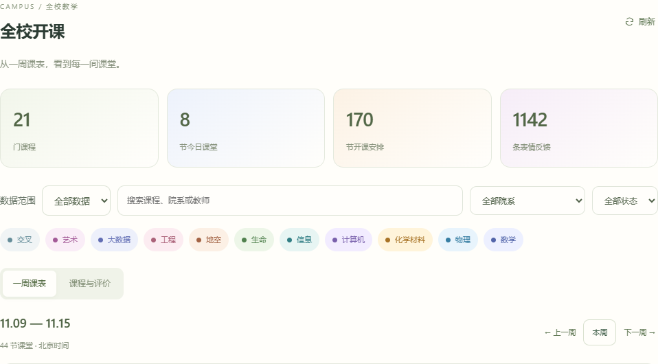

*图 1  管理员端真实首页局部  院系颜色与筛选入口*

**截图说明：**截图来自独立测试环境 http://127.0.0.1:18082/；日常项目地址仍为 http://127.0.0.1:18080/。两者页面程序相同，数据库独立。人物、排课、笔记与留言均为合成演示内容；截图中的加入码只用于本次演示。

蓝色编号框为后加引导，数字只在当前图片内对应。截图保留真实界面状态；局部图在图注说明。

## 阅读索引与首次体验

| 场景编号 | 阅读内容 | 适合使用者 |
| --- | --- | --- |
| 01—03 | 登录 注册 账号安全 演示切换 | 全部身份 |
| 04—10 | 课程详情 加入码 感受 评价 历史 问题 指引 | 学生 |
| 11—15 | 笔记 查询导出 日期回顾 个人资料 头像 | 学生及个人资料使用者 |
| 16—20 | 学伴查找 双向确认 留言 请假 消息 | 学生为主 |
| 21—28 | 教学待办 排课 邀请 回应 发布 审批 统计 反思 | 教师 |
| 29 | 课堂表情识别的开启与图片试用 | 教师 管理员 |
| 30—35 | 全校课表 院系 课程 账号 名单 数据范围 | 管理员及本地演示维护者 |

#### 先走通一条师生流程

先选择演示学生，在“我的课堂”选中一节进行中课堂，提交感受与匿名问题。切换演示教师，回应该问题并正式发布学习指引。再切回学生，查看消息、阅读指引并写笔记；最后在个人回顾中点击一天的节点查看详情。

#### 分清操作窗口与统计单位

| 操作 | 开放窗口 | 统计内容 |
| --- | --- | --- |
| 表情反馈 | 开始后至结束后 30 分钟前 | 可多次记录，按条统计 |
| 四项课程评价 | 开始后至结束后 30 分钟前 | 每人每节一份，可在窗口内更新 |
| 匿名新问题 AI 识别 | 课堂进行中 | 问题卡或过滤后的匿名识别结果 |

加入码只出现在“添加课程”流程中。课程已经加入后，日常直接选择正在进行或刚结束的课堂，不需要反复输入。

**日期阅读：**个人回顾及趋势图按 UTC 日期分组；课表与请假日期使用北京时间。示例发生在北京时间清晨，因此截图中的前一 UTC 日期属于正常分组。

## 通用：登录与账号

### 01  登录并确认身份

**使用场景：**准备上课、处理教学待办，或查看全校安排。

**入口：**登录 → 进入课堂 → 当前工作台

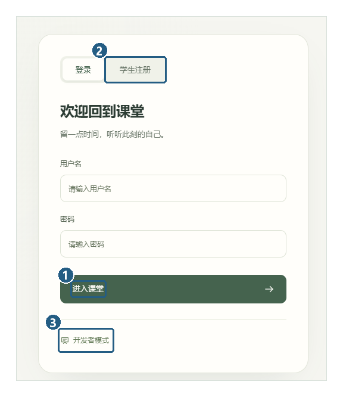

*图 2  登录入口局部  输入账号后进入对应身份*

[1] 进入课堂  [2] 学生注册  [3] 开发者模式

**操作 1：**打开 http://127.0.0.1:18080/，输入已有用户名和密码，点击“进入课堂”。

**操作 2：**核对侧栏账号与身份，再选择需要的功能。学生、教师和管理员应分别使用对应账号。

**界面反馈：**学生默认打开“我的课堂”，教师打开“教学工作台”，管理员打开“开课总览”；导航随身份改变。

**注意事项：**登录过期后重新登录。文档和演示材料中不展示密码；退出前先保存当前编辑内容。

### 02  学生注册与账号安全

**使用场景：**新学生建立账号，已有用户维护登录密码。

**入口：**学生注册 → 个人资料 → 账号安全

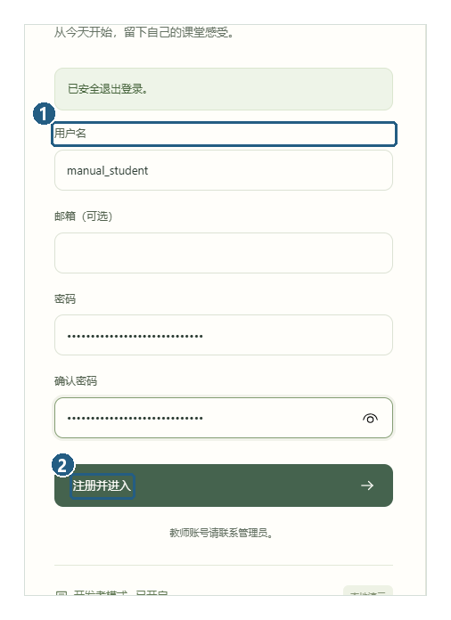

*图 3  真实注册表单局部  示例账号 manual_student*

[1] 用户名  [2] 注册并进入

**操作 1：**在登录卡片选择“学生注册”，填写用户名、可选邮箱、密码和确认密码，点击“注册并进入”。

**操作 2：**登录后进入“账号安全”，按表单填写原密码及两次新密码，再提交修改。

**界面反馈：**用户名支持 3～254 位，密码为 10～128 位且包含字母和数字；格式错误、重名或两次密码不一致时显示提示。

**实操核对：**本次实际注册 manual_student 并成功进入学生工作台；随后通过加入码加入课程。账号安全的入口见下一页补充图，修改成功会要求重新登录。

**注意事项：**教师账号由管理员创建。用户名可使用邮箱式写法，但“联系邮箱”仍是单独的可选资料字段。

#### 账号安全操作补充

注册后，使用“账号安全”维护登录密码。不要把演示切换入口当作正式账号的密码管理。

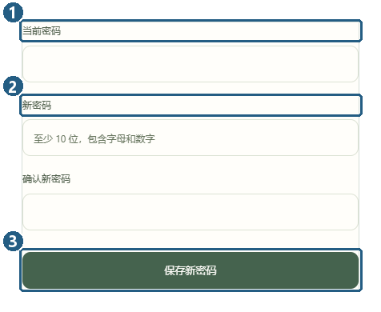

*图 4  当前密码 新密码与确认密码  修改后重新登录*

[1] 当前密码  [2] 新密码  [3] 保存新密码

**操作：**填写当前密码、新密码和确认密码，点击“保存新密码”。两次新密码须一致，且新密码与当前密码不同。

**界面反馈：**修改成功后会退出已有登录；请用新密码重新进入。忘记当前密码时，联系管理员或使用受控的本地演示成员重设流程。

### 03  开启本地演示和切换身份

**使用场景：**答辩时连续展示学生、教师及管理员的对应页面。

**入口：**开发者模式 → 开启演示开发者模式 → 选择身份

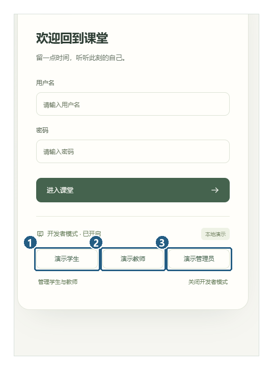

*图 5  本地演示快捷入口  学生 教师 管理员*

[1] 演示学生  [2] 演示教师  [3] 演示管理员

**操作 1：**在提供本地演示能力的登录页展开“开发者模式”，点击“开启演示开发者模式”。

**操作 2：**选择演示学生、演示教师或演示管理员；进入后可用顶部切换栏继续切换，结束时关闭开发者模式。

**界面反馈：**切换会重新进入所选身份的工作台，不需要在快捷入口填写密码。普通启动默认不开放此模式。

**注意事项：**有未保存资料、笔记、评价或教学草稿时，先保存或放弃。demo_buddy 属于普通学生，学伴是学生好友关系。

## 学生：课程与个人空间

### 04  浏览课程卡片与一周课表

**使用场景：**查看今天和晚间的安排，回到某一节具体课堂。

**入口：**我的课程 → 课程卡片或课程表 → 课程详情

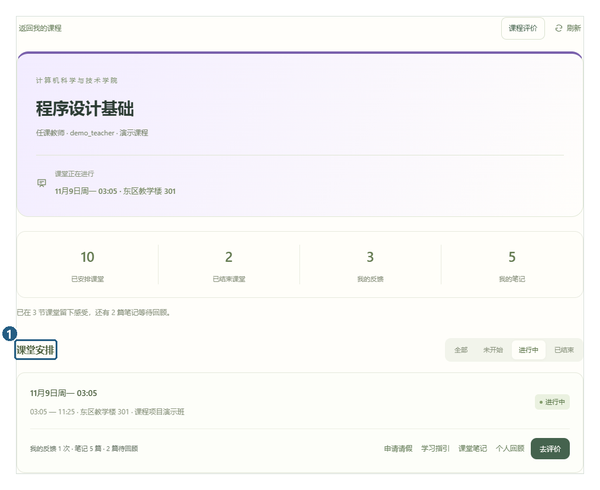

*图 6  学生课程详情  已筛选进行中的课堂*

[1] 课堂安排

**操作 1：**在“我的课程”按课程、院系或教师查找，按需切换“课程卡片”与“课程表”，核对上课时间和地点。

**操作 2：**点击课程卡片进入详情，按“未开始”“进行中”“已结束”筛选安排，在目标课堂选择相应入口。

**界面反馈：**详情展示任课教师、下一次课堂和个人记录概览；可以进入该节评价、笔记或个人回顾。院系颜色在卡片与课表中保持一致。

**注意事项：**本人反馈次数和笔记数用于回顾学习，不代表出勤率或成绩。先核对课程、日期和班级，再进入课堂。

#### 课程卡片与课表操作补充

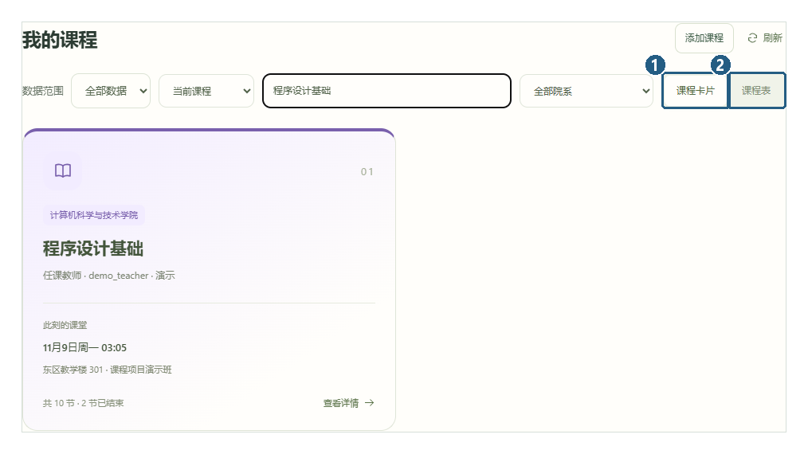

*图 7  按名称筛选后的课程卡片  点击卡片进入详情*

[1] 课程卡片  [2] 课程表

**操作：**列表中的搜索支持课程、院系、教师；用“课程卡片”“课程表”切换视图。课程详情中的状态筛选只改变显示范围，不会取消已安排课堂。

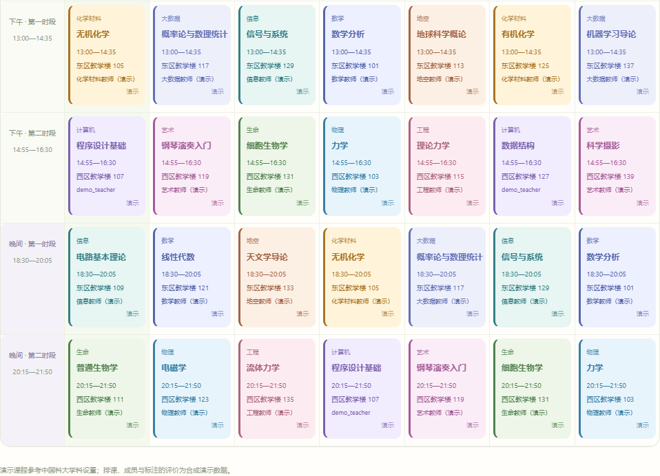

*图 8  全校课表下午与晚间局部  学生课表使用相同院系颜色*

**阅读方法：**课表按北京时间展示。课程颜色来自院系设置，同一院系保持一致；夜间课堂同样有具体日期、教室和教师。

### 05  使用加入码添加课程

**使用场景：**首次加入一门课程，之后按课表正常上课。

**入口：**我的课程 → 添加课程 → 输入 8 位码

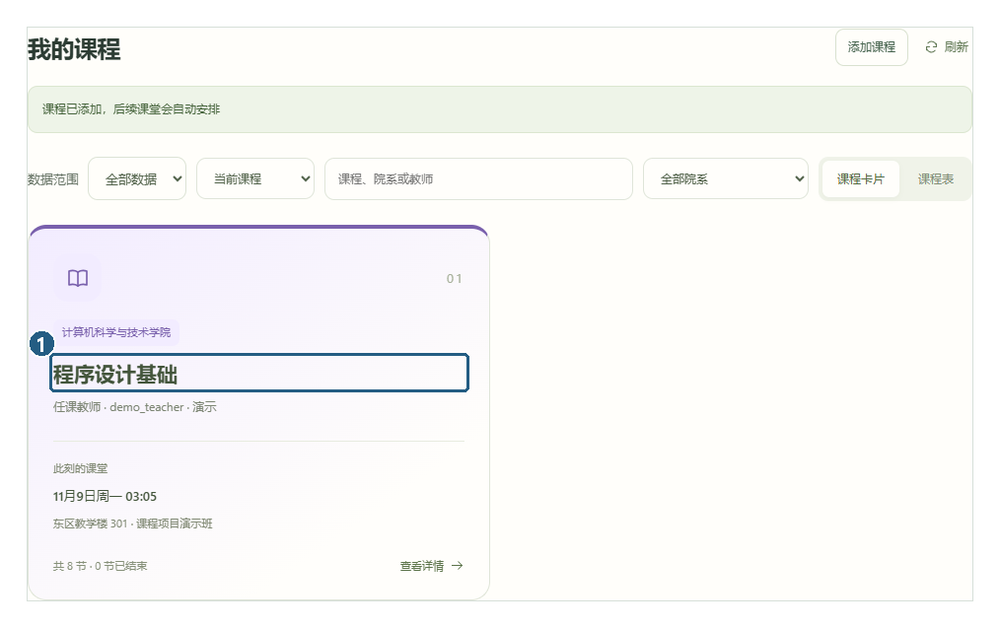

*图 9  填写加入码后  新学生已加入程序设计基础*

[1] 程序设计基础

**操作 1：**向任课教师取得有效的 8 位加入码，在“我的课程”点击“添加课程”，输入后提交。

**操作 2：**添加成功后回到列表，打开新增课程，核对当前未结束课堂的安排。

**界面反馈：**添加入口收起，课程出现在列表；后续新建课堂会自动安排有效课程成员。重复输入有效码不会重复加入。

**实操核对：**本次新注册学生提交教师生成的有效码后，“程序设计基础”出现在课程列表，页面显示添加成功。

**注意事项：**日常评价无需反复输入加入码。无效、过期、停用或托管课堂已结束时不能添加；当前没有退出整门课程入口。

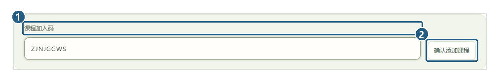

*图 10  添加课程时填写 8 位加入码*

[1] 课程加入码  [2] 确认添加课程

### 06  提交一次课堂感受

**使用场景：**课堂中记录此刻感受，或在刚下课时回想这节课。

**入口：**我的课堂 → 选择课堂 → 提交本次感受

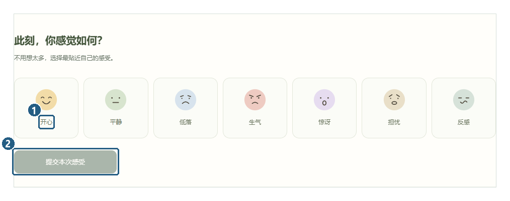

*图 11  手动表情反馈面板  先选感受再提交*

[1] 开心  [2] 提交本次感受

**操作 1：**在默认的“进行中与刚结束”范围选择课堂，核对课程、时间与课堂状态。

**操作 2：**点击最贴近当前感受的表情，再点击“提交本次感受”，查看成功提示与本人的反馈历史。

**界面反馈：**记录保存到所选课堂。手动反馈从课堂开始开放，到课堂结束后 30 分钟截止；截止时刻起不能继续提交。

**实操核对：**本次选择“开心”并提交后，该课堂个人历史新增了一条手动反馈；教师实时看板也显示相应反馈。

**注意事项：**“全部课堂”可用于回看旧课，不会重新开放过期评价。学生看自己的记录，教师查看所授课堂的汇总与反馈。

### 07  查看个人情绪历史

**使用场景：**回看此前课堂中的本人记录。

**入口：**情绪历史 → 选择课堂或全部历史 → 翻页

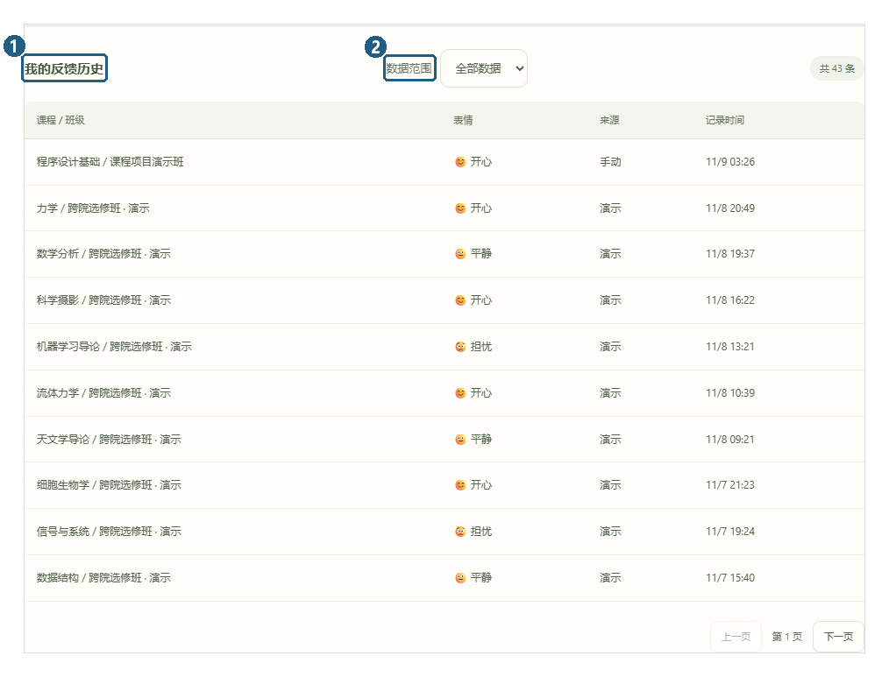

*图 12  本人情绪历史  可按范围查询及翻页*

[1] 我的反馈历史  [2] 数据范围

**操作 1：**从侧栏进入“情绪历史”，选择某节课堂或“全部课堂历史”，再核对当前数据范围。

**操作 2：**查看感受、来源和时间，使用上一页、下一页访问更早记录。需要文字复盘时转到“笔记与回顾”。

**界面反馈：**列表只返回当前学生有权读取的个人历史；切换条件后应以新结果及对应总数为准。

**注意事项：**图表中的反馈次数不等于参与人数。同一个人可以有多次手动反馈，匿名 AI 结果不能并入个人手动回顾。

### 08  填写四项课程评价

**使用场景：**针对讲解和学习体验，留下比单个表情更具体的反馈。

**入口：**课程评价 → 四项评分 → 提交或更新

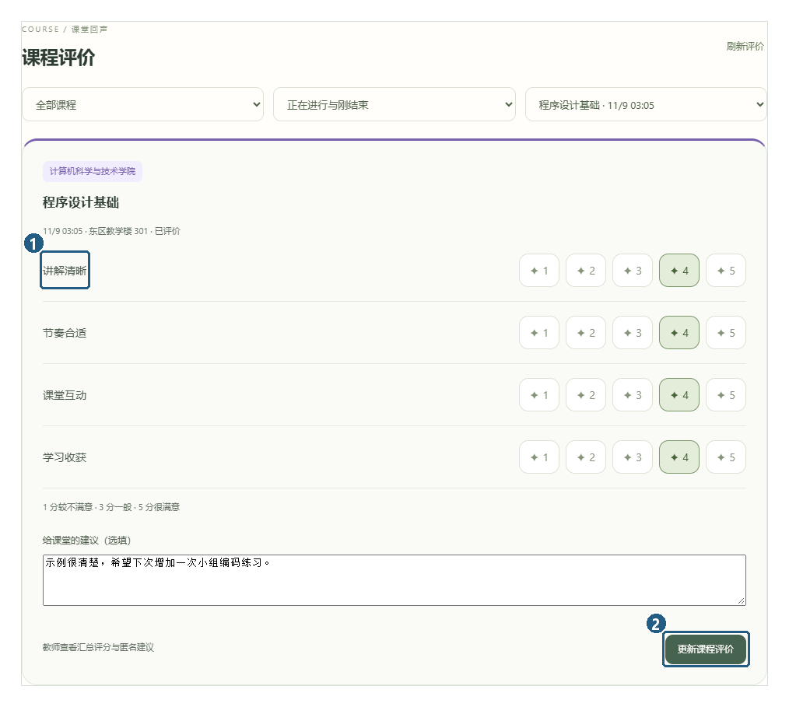

*图 13  四项评分已经保存  窗口内可更新*

[1] 讲解清晰  [2] 更新课程评价

**操作 1：**在课堂点击“填写完整课程评价”，或从侧栏“课程评价”选择目标课堂。

**操作 2：**为讲解清晰、节奏合适、课堂互动、学习收获各选 1～5 分，可填写匿名建议，再提交；窗口内可更新。

**界面反馈：**每名学生每节课堂保留一份完整评价，建议最多 1000 字。历史评价可回看，过期后不能修改。

**实操核对：**本次四项均选择 4 分并填写建议后保存成功；教师端同一课堂显示一份评价，四项均分均为 4.0。

**注意事项：**四项评分与表情记录独立保存，开放窗口相同。教师查看汇总和匿名建议；建议正文中自述姓名仍可能暴露身份。

### 09  匿名提问并查看回应

**使用场景：**听课时希望再举例、重复讲解或放慢进度。

**入口：**我的课堂 → 匿名问题卡 → 老师回应

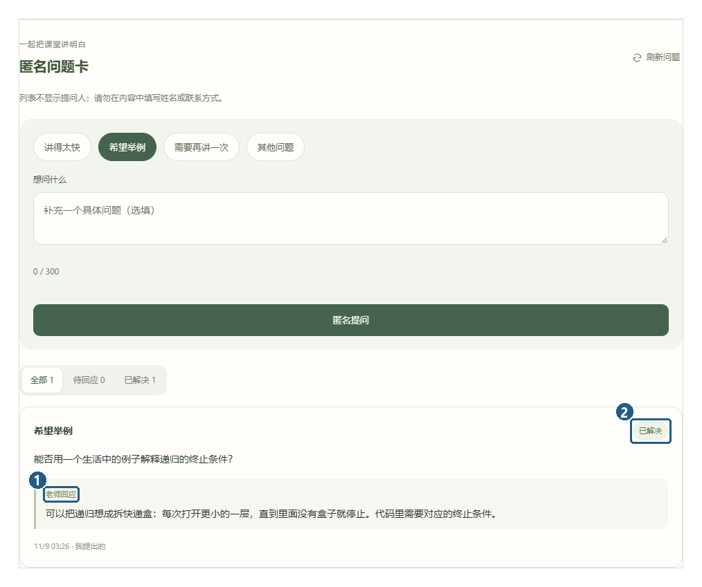

*图 14  学生匿名问题与教师回应同页展示*

[1] 老师回应  [2] 已解决

**操作 1：**在进行中课堂选择“讲得太快”“希望举例”“需要再讲一次”或“其他问题”；可补充具体内容，点击“匿名提问”。

**操作 2：**教师回复后，在同一课堂的问题卡查看“老师回应”，也可通过消息中心返回。

**界面反馈：**列表不显示提问账号，问题可按全部、待回应、已解决筛选。教师填写回应后还可标记解决或重新打开。

**实操核对：**本次问题是“能否用一个生活中的例子解释递归的终止条件”；教师保存“拆快递盒”的例子后，学生页面展示回应及已解决状态。

**注意事项：**问题正文最多 300 字，“其他问题”须填写内容。课后仍可查看回应，但只有课堂进行中可新提问；同一课堂的名单学生可看到匿名问题卡。

### 10  阅读已发布学习指引

**使用场景：**课前明确重点，课后继续完成练习。

**入口：**课程详情或课堂 → 学习指引 → 本节笔记

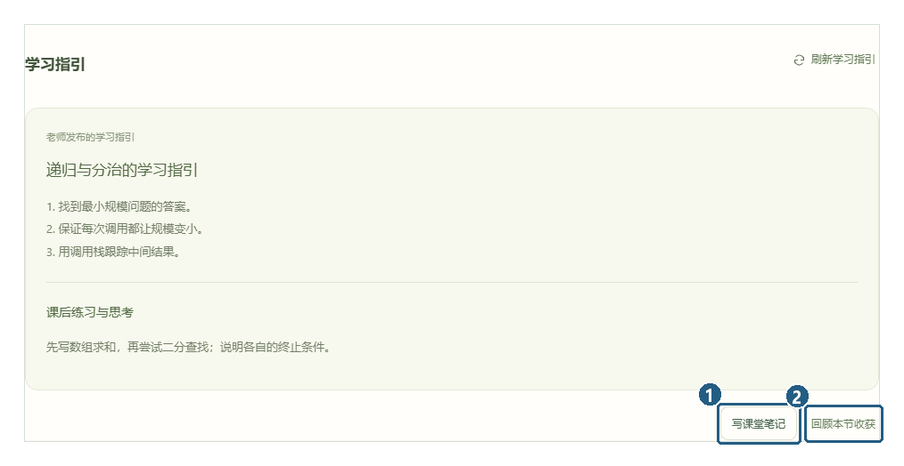

*图 15  学生已读到教师正式发布的学习指引*

[1] 写课堂笔记  [2] 回顾本节收获

**操作 1：**在课程详情打开已发布的“学习指引”，阅读标题、学习要点和练习与思考；需要时手动刷新。

**操作 2：**选择“写课堂笔记”或“回顾本节收获”，继续记录学习过程。

**界面反馈：**笔记入口定位当前课堂；回顾入口打开该节近 90 天记录。学生只能读取正式发布的内容，教师草稿不对学生展示。

**实操核对：**本次发布“递归与分治的学习指引”后，学生可看到三个学习要点和课后练习，并可继续写该节课堂笔记。

**注意事项：**须在这节课堂的实际名单中才能读取指引。教师更新后以成功刷新的版本为准；撤下后不再提供已发布内容。

### 11  保存课堂笔记与个人随记

**使用场景：**记下知识点、自己的收获和下一步练习。

**入口：**笔记与回顾 → 我的笔记 → 新建并保存

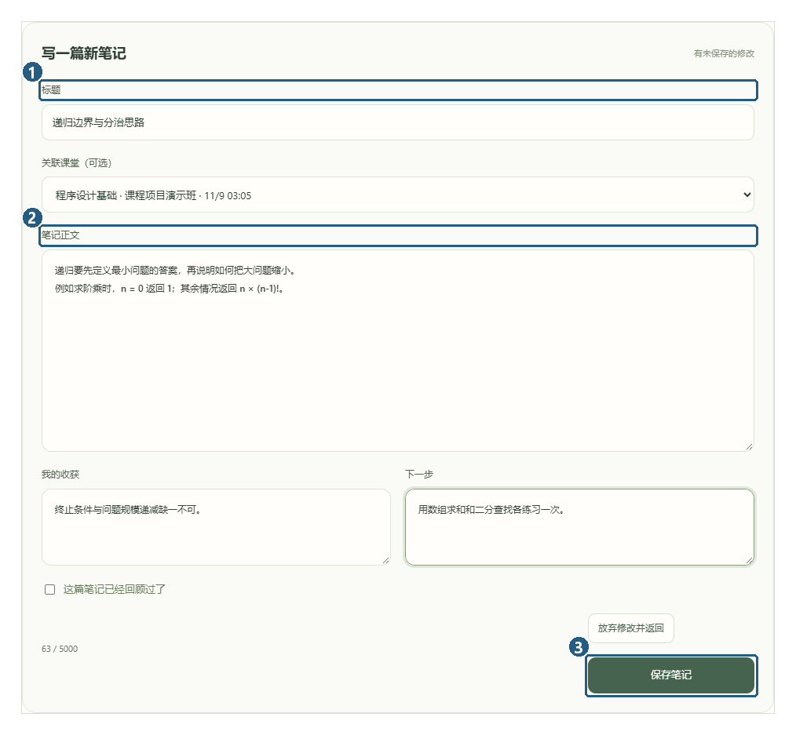

*图 16  课堂笔记编辑  正文 收获与下一步*

[1] 标题  [2] 笔记正文  [3] 保存笔记

**操作 1：**新建笔记，填写标题、正文，可选关联课堂，再填写“我的收获”和“下一步”；未关联课堂即个人随记。

**操作 2：**点击“保存笔记”。复习后重新打开，勾选“已经回顾过了”，再次保存以更新回顾状态。

**界面反馈：**保存后列表显示该笔记，后续可继续编辑。标题和正文必填；标题 80 字、正文 5000 字，收获和下一步各 300 字。

**实操核对：**本次保存“递归边界与分治思路”，关联程序设计基础课堂，保存后可重新打开；个人回顾的当天详情也能找到它。

**注意事项：**笔记为学生个人空间，教师、管理员和学伴没有应用读取入口。未保存草稿不能保证在强制关闭或登录过期后恢复。

### 12  组合查找和导出笔记

**使用场景：**找回特定课堂的复习材料，或整理待回顾清单。

**入口：**我的笔记 → 条件查询 → 导出笔记

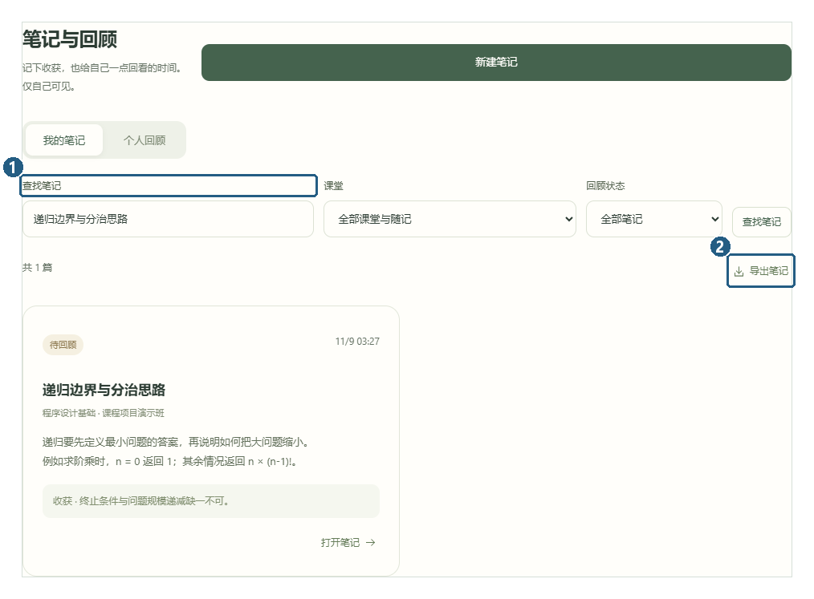

*图 17  按笔记标题查找后的真实列表*

[1] 查找笔记  [2] 导出笔记

**操作 1：**组合文字、课堂及待回顾／已回顾条件，执行查询；文字覆盖标题、正文、收获和下一步。

**操作 2：**确认列表后点击“导出笔记”，保存 CSV；列表默认按最后修改时间倒序，每页 12 篇。

**界面反馈：**导出对应已查询的条件。条件改动但未查询时不能直接导出，避免文件与当前结果不一致。

**实操核对：**本次按“递归边界与分治思路”查到一篇对应笔记；此前已通过真实浏览器完成笔记 CSV 下载。

**注意事项：**切换栏目遇到未保存提示时先保存或明确放弃。删除笔记需二次确认且不能恢复；个人导出文件应妥善保存。

### 13  点击日期节点回顾一天

**使用场景：**查看趋势中某一天具体发生了哪些记录。

**入口：**个人回顾 → 选择天数 → 点击日期节点

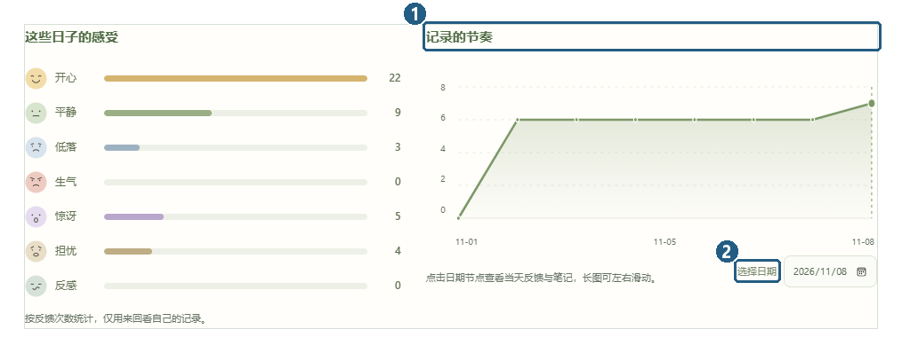

*图 18  可点击的日期曲线与日期选择入口*

[1] 记录的节奏  [2] 选择日期

**操作 1：**切到“个人回顾”，选择近 7、30 或 90 天，可再选课堂；点击“记录的节奏”中的日期节点，或用日期框定位。

**操作 2：**在下方查看当天手动反馈和新建笔记，翻页或点击“打开当天笔记”；可进一步打开待回顾笔记或导出回顾。

**界面反馈：**节点高亮并展开详情，零反馈日期也可选。键盘左右键切日期，Home／End 到首尾，Enter／空格选中；长图支持横向滚动。

**实操核对：**本次点击曲线最后一个日期节点后，高亮日期并展开 2026/11/08 的记录，包含手动反馈与当天新建笔记；详情截图见下一页。

**注意事项：**当前按 UTC 日期汇总；北京时间清晨可能归前一 UTC 日。笔记按创建时间归日，待回顾数统计当前课堂范围内全部时间。

#### 点击日期后的详情

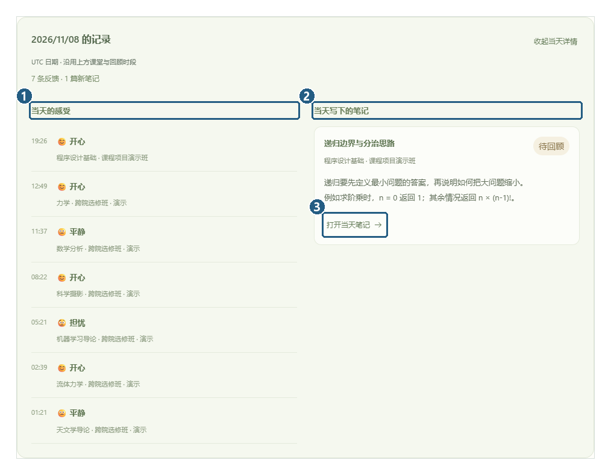

*图 19  点击日期节点后出现的真实当天详情*

[1] 当天的感受  [2] 当天写下的笔记  [3] 打开当天笔记

**操作：**左侧是当天手动感受，右侧是当天新建笔记。点击“打开当天笔记”进入笔记编辑，使用“收起当天详情”返回趋势浏览。

**界面反馈：**本例选择 2026/11/08。北京时间清晨的新记录属于前一 UTC 日，页面已经标明“UTC 日期”。当天没有记录也可选择，不会补造数据。

**下一步：**下一步可以打开待回顾笔记并勾选已回顾，再保存；也可以导出所选范围的个人回顾。

### 14  编辑主页和学习偏好

**使用场景：**让其他学生通过专业、兴趣和目标了解自己。

**入口：**个人资料 → 编辑资料与学习偏好 → 保存资料

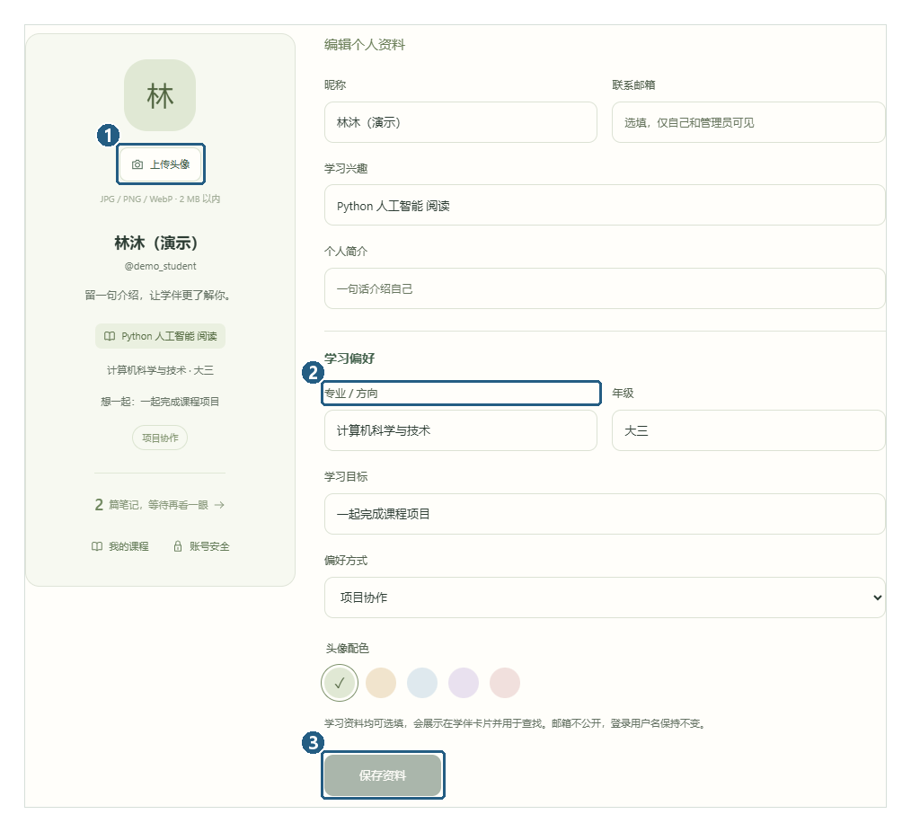

*图 20  个人资料编辑区局部  学习特征与资料保存*

[1] 上传头像  [2] 专业 / 方向  [3] 保存资料

**操作 1：**进入“个人资料”的个人主页，填写昵称、简介、兴趣、专业方向、年级、学习目标及偏好方式。

**操作 2：**按需要修改联系邮箱与配色，点击“保存资料”；不保留当前修改时选择“撤销修改”。

**界面反馈：**保存后资料预览和导航身份更新。概览卡片显示当前账号的相应统计，点击可进入课程、笔记等对应功能。

**实操核对：**本次保存昵称、计算机专业、大三、Python 兴趣与项目协作偏好后，个人预览及侧栏更新。

**注意事项：**学习资料均可选填，会用于学伴展示和查找；联系邮箱不向学伴公开。此处不修改登录用户名或账号角色。

### 15  上传裁剪头像

**使用场景：**为个人主页、侧栏和学伴卡片设置可辨认的形象。

**入口：**上传头像 → 调整大小和位置 → 保存头像

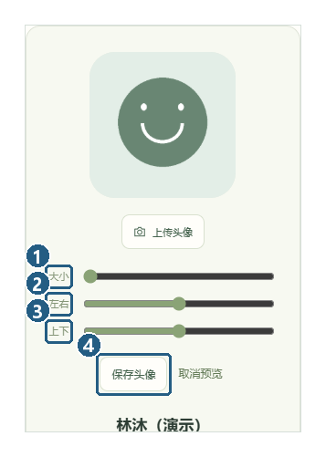

*图 21  头像预览局部  大小和位置调整后单独保存*

[1] 大小  [2] 左右  [3] 上下  [4] 保存头像

**操作 1：**选择不超过 2 MB 的 JPG、PNG 或 WebP 静态图片，原图宽高为 32～4096 像素。

**操作 2：**用“大小”“左右”“上下”调整预览，再点击“保存头像”；不满意可取消预览，已有头像可确认后恢复默认。

**界面反馈：**选择文件只生成预览，保存后才更新头像。刷新后保留已保存图片，头像失效时回退文字头像。

**实操核对：**本次使用项目绘制的笑脸图进行上传、预览和保存，保存后按钮变为“更换头像”，侧栏同步更新。

**注意事项：**头像和文字资料分别保存。学生头像可向登录学生展示；匿名留言不提供作者头像。摄像头不存媒体的规则不适用于主动保存的头像。

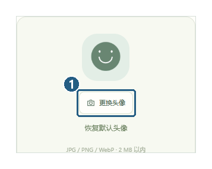

*图 22  保存后头像更新  预览与保存是两个步骤*

[1] 更换头像

### 16  按多种属性查找学伴

**使用场景：**寻找同方向、同年级或适合一起做项目的伙伴。

**入口：**好友学伴 → 关键词和属性 → 查找

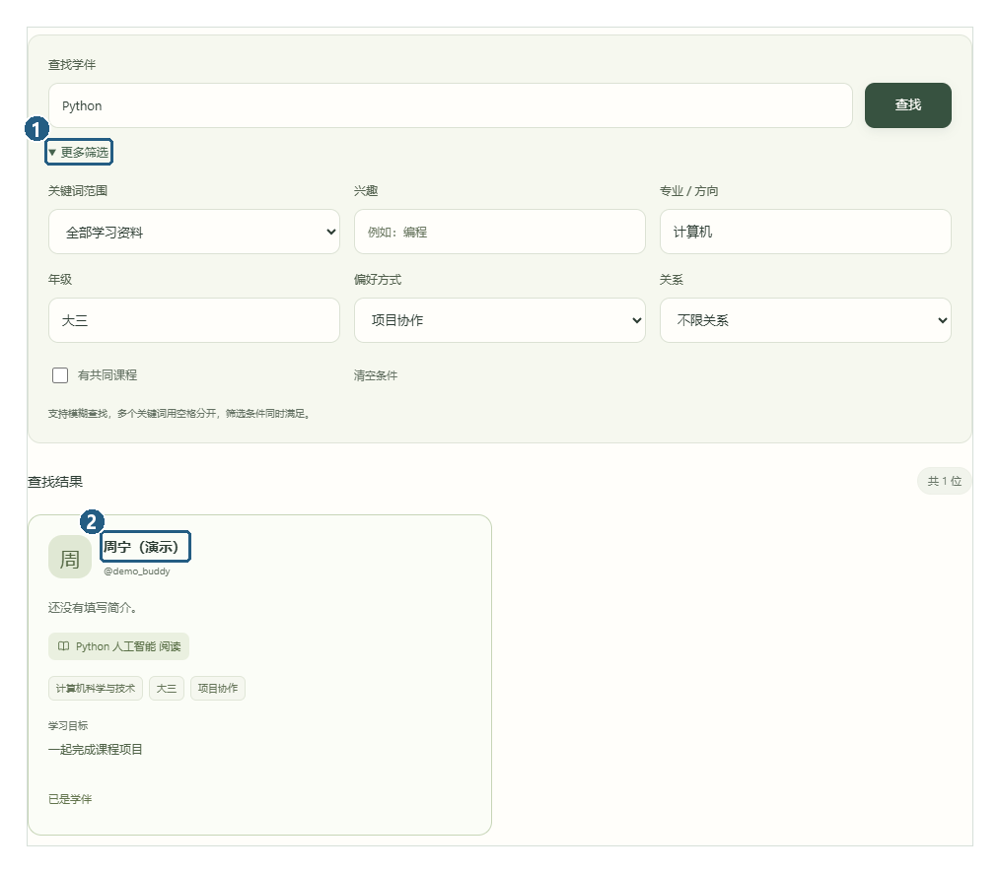

*图 23  组合 Python 计算机 大三 项目协作  返回一位学伴*

[1] 更多筛选  [2] 周宁（演示）

**操作 1：**输入关键词，可限定用户名、昵称、兴趣等字段；再按兴趣、专业、年级、偏好方式、关系或共同课程组合筛选。

**操作 2：**执行查询，浏览学生卡片；例如关键词 Python、专业计算机、偏好项目协作。无结果时逐步减少条件。

**界面反馈：**结果只包含符合条件的有效学生，每页 12 位。多组关键词须每组匹配，其他已设条件也同时满足。

**实操核对：**本次组合关键词 Python、专业计算机、年级大三、偏好项目协作，返回周宁（演示）一位学生，说明多项条件共同生效。

**注意事项：**空白查询至少设置一项条件。共同课程筛选不会公开对方课程与班级名单；未填写某属性不代表具有该特征。

### 17  申请和管理好友学伴

**使用场景：**由双方明确同意建立学习伙伴关系。

**入口：**添加学伴 → 收到的申请 → 我的学伴

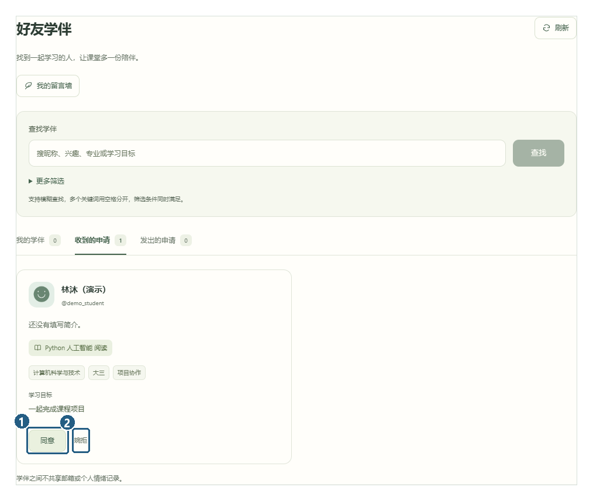

*图 24  接收方视角  明确同意后才建立关系*

[1] 同意  [2] 婉拒

**操作 1：**在学生卡片点击“添加学伴”。接收方到“收到的申请”选择同意或婉拒；发送方可撤回尚未处理的申请。

**操作 2：**通过后在“我的学伴”查看卡片。需要结束关系时，在对应入口核对并确认移除。

**界面反馈：**接收方同意后才建立双向关系；反向发送申请不会自动通过。收到申请和通过申请会产生站内提醒。

**实操核对：**本次演示学生发起申请，demo_buddy 通过普通登录进入接收方页面并点击同意，双方学伴列表随后建立关系。

**注意事项：**学伴是学生间的好友，不能读取彼此情绪历史或私人笔记，也不会扩大课堂权限。教师、管理员没有学生学伴入口。

### 18  发布匿名或可查看来源的留言

**使用场景：**给学伴鼓励，或留下便于继续交流的学习建议。

**入口：**好友学伴 → 我的留言墙或去留言 → 发布

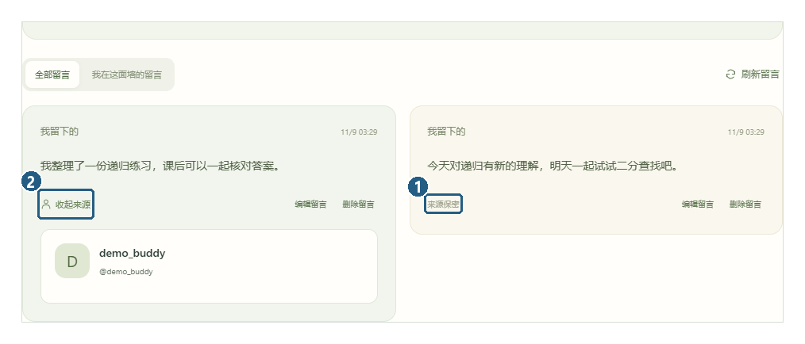

*图 25  真实留言列表局部  来源保密与点击展开来源*

[1] 来源保密  [2] 收起来源

**操作 1：**进入自己或已确认学伴的墙，填写 1～600 字正文，选择“匿名留言”或“允许点击查看来源”，核对后发布。

**操作 2：**对允许查看来源的留言，点击来源按钮展开公开学习资料；作者可修改正文，作者和墙主可删除。

**界面反馈：**匿名留言不能揭示作者；可查看来源的留言在点击后才显示资料。两种方式发布后不能直接互换。

**实操核对：**本次发布两条留言：一条匿名，仅显示“来源保密”；另一条允许查看来源，点击后显示作者公开学习资料。

**注意事项：**同墙受众包括墙主及墙主当前已确认学伴，并非两人私信。删除需确认且不可恢复；解除关系后仍可从“我发出的留言”删除自己的内容。

#### 留言发布操作补充

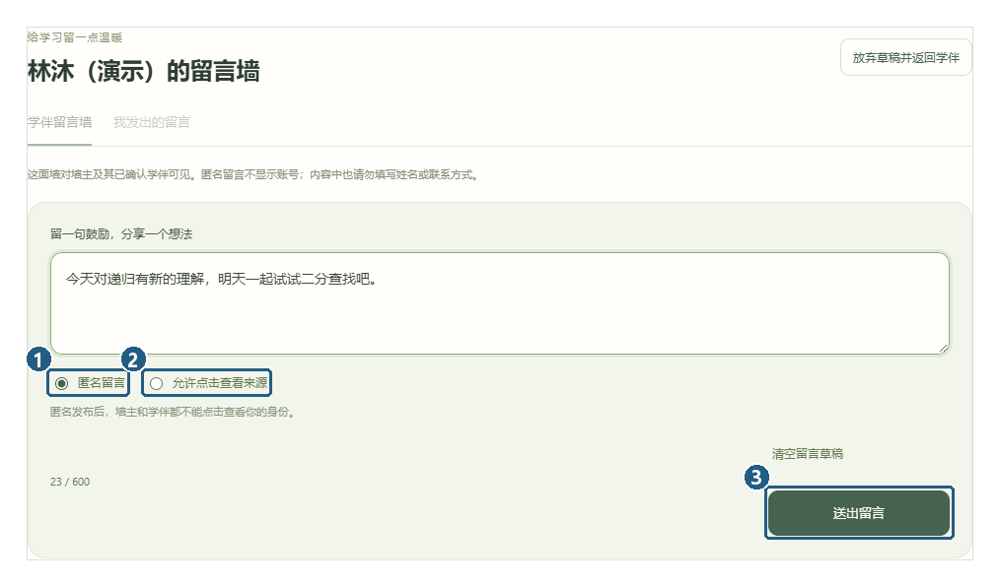

*图 26  填写留言  选择来源方式  送出留言*

[1] 匿名留言  [2] 允许点击查看来源  [3] 送出留言

**操作：**匿名与允许查看来源在发布前选择。正文最多 600 字；来源方式发布后保持不变，修改留言只修改正文。

**权限：**墙主及当前已确认学伴可以查看这面墙。作者可修改正文，作者和墙主可确认删除；来源保密的留言不会提供身份展开按钮。

### 19  按具体课堂提交请假

**使用场景：**无法参加某一节尚未结束的课堂。

**入口：**请假申请 → 申请请假 → 查看审批结果

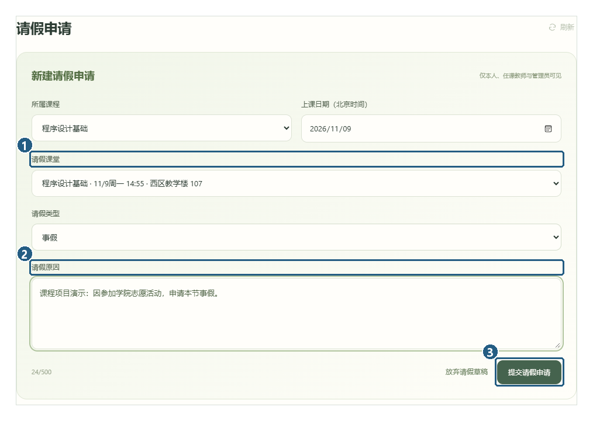

*图 27  按具体课堂提交请假  表单局部*

[1] 请假课堂  [2] 请假原因  [3] 提交请假申请

**操作 1：**按课程与北京时间日期选定课堂，填写病假、事假或其他，补充 2～500 字原因并提交；课程详情也有直达入口。

**操作 2：**按课程与状态查找申请，查看教师回复和处理时间；待审批可确认后撤回，驳回或撤回后可在课前重新申请。

**界面反馈：**每份申请对应一节课；已有待审批或同意记录时不能重复提交。审批后学生收到消息，状态显示已同意或已驳回。

**实操核对：**本次为程序设计基础的一节未来课堂提交事假；教师同意后，学生端显示“已同意”以及“课后查看学习指引并补齐练习”的回复。

**注意事项：**结束后不能新申请，已同意或驳回不能撤回。请假不移出名单、不补造反馈，也不自动判定考勤。

#### 学生查看请假结果

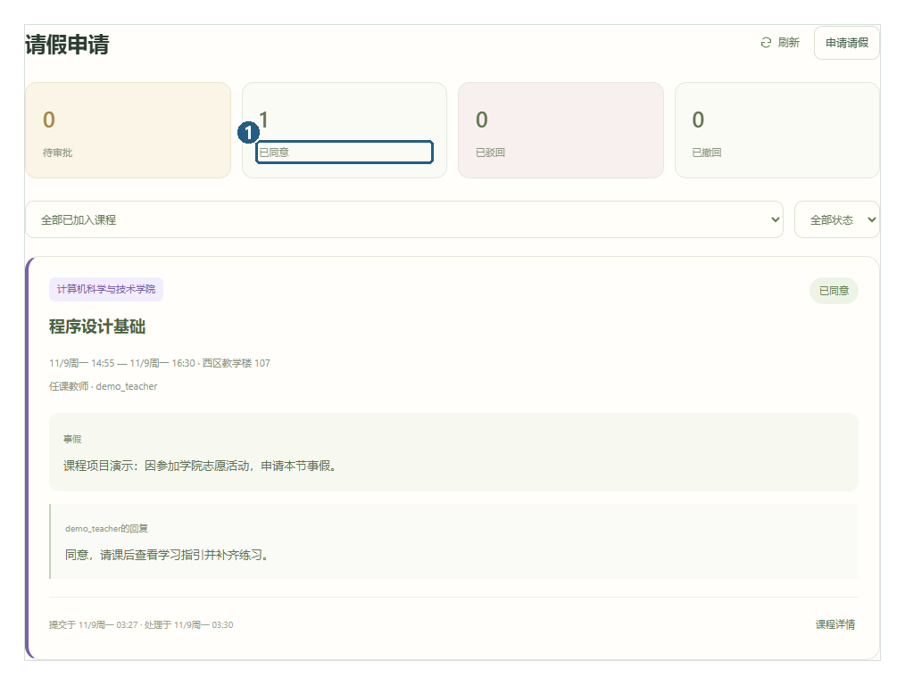

*图 28  教师审批后  学生看到已同意及回复*

[1] 已同意

**操作：**从“请假申请”按课程、状态查找。处理时间、结果与教师回复都在申请卡片显示，消息中心也会提供提醒。

**注意事项：**请假针对单节课堂，不代表退出课程，也不自动生成出勤或反馈。未审批前可撤回；已处理申请不能直接撤回。

### 20  从消息中心返回处理入口

**使用场景：**集中查看请假进展、问题回复、指引及学伴动态。

**入口：**消息中心 → 筛选消息 → 查看详情

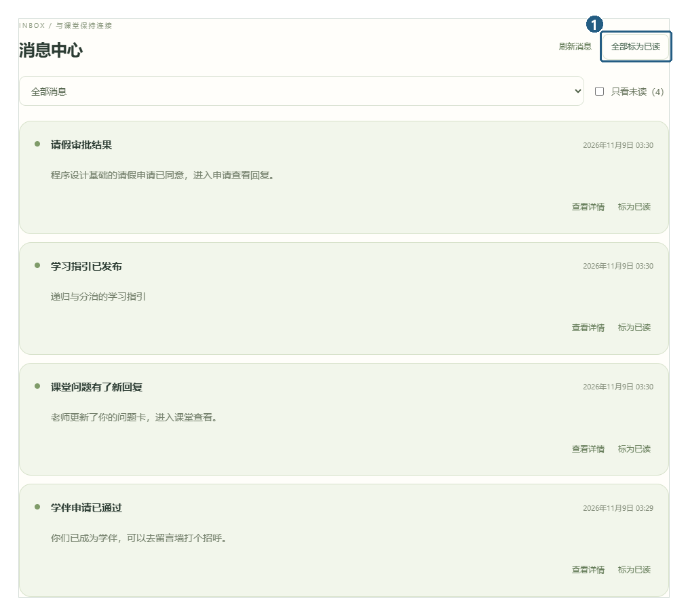

*图 29  当前学生收到的业务消息  可查看详情或标为已读*

[1] 全部标为已读

**操作 1：**按消息类型或“只看未读”筛选，点击“查看详情”进入对应课堂或处理页。

**操作 2：**使用“标为已读”或“全部标为已读”整理提醒，必要时点击“刷新消息”。

**界面反馈：**查看详情将该条标为已读，并跳转相应功能。侧栏未读数约每 30 秒刷新，只展示当前收件人的消息。

**实操核对：**本次消息中心实际出现学伴申请处理、问题回应、学习指引发布和请假审批消息；点击详情可返回对应业务页面。

**注意事项：**已读不等于完成审批或解决问题。仅通知新发生的业务事件，不自动补发所有旧事件，也不发送站外邮件。

## 教师：教学工作台

### 21  从教学工作台定位待办

**使用场景：**上课前查看安排，课后集中跟进未完成事项。

**入口：**教学工作台 → 状态筛选 → 指定课堂

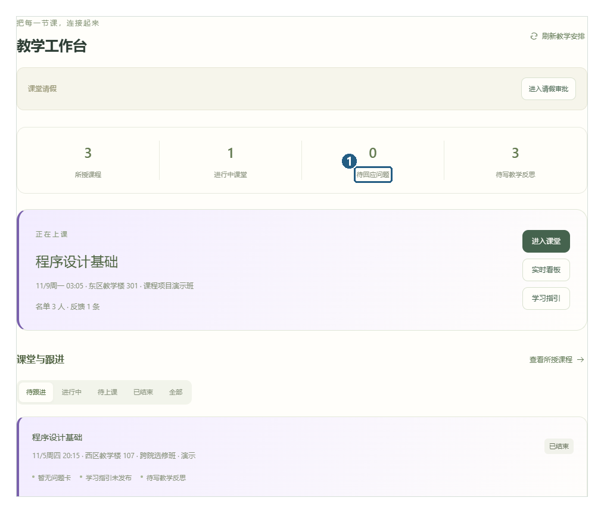

*图 30  教师工作台上部  当前课堂与教学待办*

[1] 待回应问题

**操作 1：**查看所授课程、进行中课堂、待回应问题、待审批请假和待填写反思；按进行中、待上课、已结束或全部筛选。

**操作 2：**在具体课堂点击“课堂反馈”“回应问题”“学习指引”或“课后小结”，需要时刷新教学安排。

**界面反馈：**入口保留选中的课程和课堂。未解决问题及已结束但无非空反思的课堂会继续出现在待办中。

**注意事项：**待办是操作提醒，不是教学评分或强制完成条件。教师仅能读取自己所授课程的课堂。

### 22  为已有课程安排新课堂

**使用场景：**增加一节未来或仍未结束的教学安排。

**入口：**我的课程 → 课程详情 → 安排新课堂

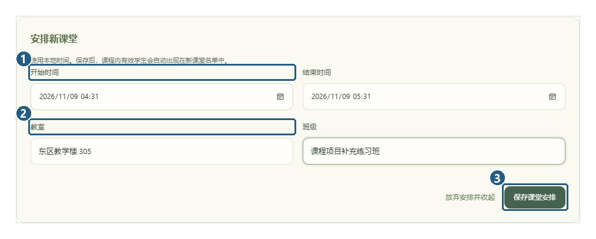

*图 31  安排新课堂  使用本地日期时间*

[1] 开始时间  [2] 教室  [3] 保存课堂安排

**操作 1：**打开本人所授课程的详情，展开“安排新课堂”，填写开始、结束时间、教室及班级。

**操作 2：**核对电脑本地时间，确保结束晚于开始且晚于当前时间，再提交，随后检查课程中的新安排。

**界面反馈：**新课堂继承本课程有效学生成员，学生端课程详情出现对应时间和地点。重试相同提交不会重复创建。

**实操核对：**本次新增“课程项目补充练习班”，教室为东区教学楼 305；保存后教师与学生的课程详情都能看到新安排。

**注意事项：**课程本身的创建和任课教师调整由管理员完成。未保存安排会阻止直接切换，避免遗失草稿。

### 23  邀请学生加入课程

**使用场景：**教师为目标学生提供一次性添加课程的入口。

**入口：**课程详情 → 邀请学生加入课程 → 课程加入码

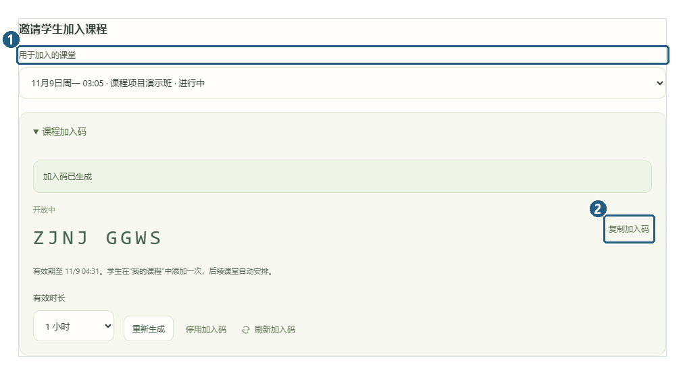

*图 32  在课程详情生成加入码  用于添加整门课程*

[1] 用于加入的课堂  [2] 复制加入码

**操作 1：**选择本课程一节未结束课堂，展开“课程加入码”，选择 15 分钟、1 小时、4 小时或 24 小时并生成。

**操作 2：**将码提供给目标学生；需要更换或关闭时，使用“重新生成”或“停用加入码”，按页面要求确认。

**界面反馈：**码最长有效至托管课堂结束，用途是加入整门课程。重新生成使旧码失效，停用不会移除已加入学生。

**实操核对：**本次教师从未结束课堂生成临时码；新注册的学生使用它成功添加课程。截图码只为示例，不能当作长期使用凭据。

**注意事项：**已结束课堂不能生成有效码。学生到“我的课程 → 添加课程”填写；教师仅管理本人课程，分享前确认对象。

### 24  回应问题并标记解决

**使用场景：**把学生的匿名问题转化为具体的教学跟进。

**入口：**课堂反馈 → 问题回应 → 保存回应

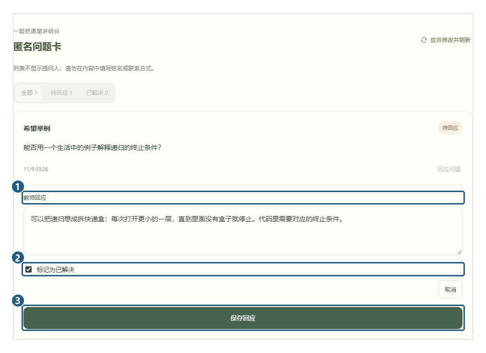

*图 33  教师填写回应  可同时标记为已解决*

[1] 教师回应  [2] 标记为已解决  [3] 保存回应

**操作 1：**选择目标课堂，在“问题回应”中按待回应或全部查找，点击“回应问题”或“编辑回应”。

**操作 2：**填写最多 1000 字回应，根据实际进展勾选“标记为已解决”，再点击“保存回应”；必要时取消解决标记。

**界面反馈：**学生在同一课堂看到回应，提问学生收到站内通知。已回复但仍处于待回应状态的问题，继续计入待跟进数。

**实操核对：**本次填写具体例子并勾选已解决，保存后学生端能看到相同回复，教师待回应问题数随之减少。

**注意事项：**列表不提供提问账号。需要学生继续阅读的共性内容，可另行整理成学习指引；个人笔记不属于教师可见材料。

### 25  区分备课草稿和正式发布

**使用场景：**先编辑学习指引，确认后再同步给学生。

**入口：**学习指引 → 保存草稿 → 发布到学生课堂

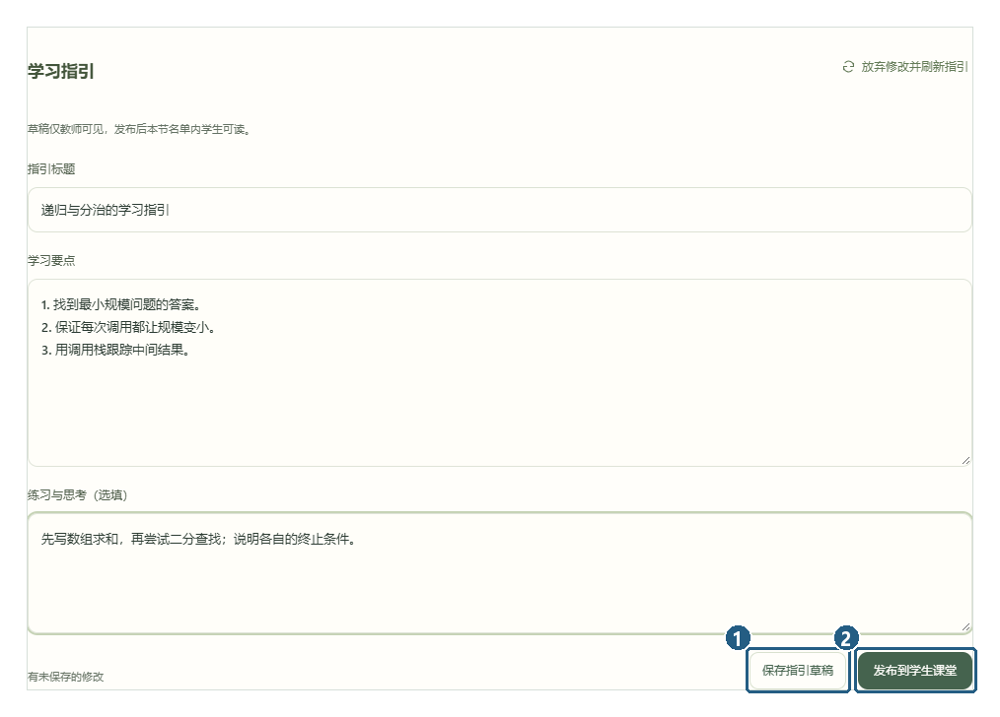

*图 34  学习指引编辑  保存草稿与正式发布分别操作*

[1] 保存指引草稿  [2] 发布到学生课堂

**操作 1：**填写标题、学习要点及练习与思考，先点击“保存指引草稿”；检查学生当前可见版本。

**操作 2：**确定内容后点击“发布到学生课堂”或“更新发布”，再由学生刷新核对；需撤下时按要求确认。

**界面反馈：**保存草稿不改变已发布版本，也不发送发布提醒。正式发布后名单内学生读到新快照并收到站内消息。

**实操核对：**本次先保存草稿，再正式发布。学生刷新后看到了相同标题、学习要点和练习；教师也可展开学生当前可见版本核对。

**注意事项：**发布时标题和要点必填，标题最多 80 字、要点 3000 字、练习思考 1500 字。撤下保留草稿，未保存编辑先处理再离开。

#### 核对学生可见版本

*图 35  正式发布后学生端显示的内容*

[1] 写课堂笔记  [2] 回顾本节收获

**核对方法：**教师可展开“查看学生当前可见版本”，学生也可在同一课堂点击“刷新学习指引”核对。保存草稿不会替换这个正式发布快照。

**界面反馈：**本次学生收到发布消息，并能从指引进入本节笔记或个人回顾。撤下已发布指引时需要确认，教师草稿仍保留。

### 26  审批所授课堂的请假

**使用场景：**处理学生提交的请假并给出明确回复。

**入口：**请假审批 → 查找申请 → 同意或驳回

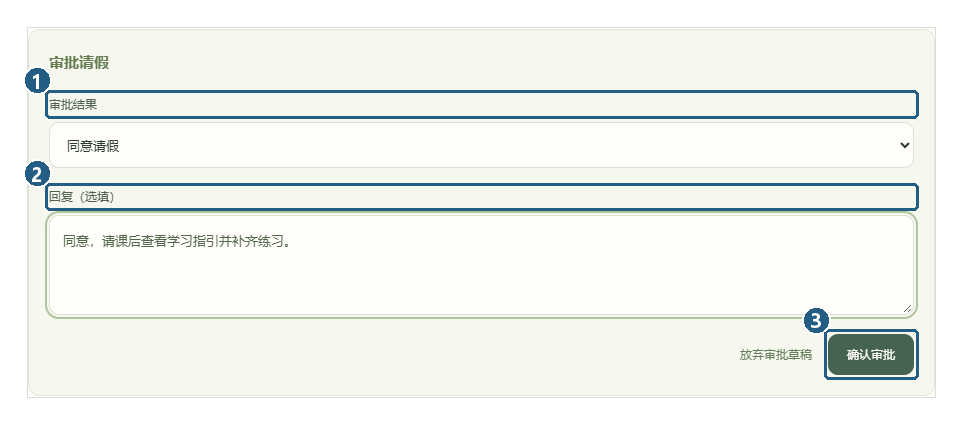

*图 36  教师审批表单  选择结果并确认*

[1] 审批结果  [2] 回复（选填）  [3] 确认审批

**操作 1：**按课程或状态定位申请，核对日期、课堂和申请内容，再选择同意或驳回。

**操作 2：**驳回须填写原因，同意可选填回复，最多 500 字；保存后让学生刷新查看结果。

**界面反馈：**申请人收到站内通知并看见处理状态、回复与时间；课堂名单显示待审批或准假标记，不公开原因正文。

**实操核对：**本次教师同意学生事假并填写补学建议，保存后待审批数减少，学生端及消息中心均能查看结果。

**注意事项：**教师可处理已结束课堂的既有申请。管理员请假记录页只读，审批由当前任课教师完成。

### 27  实时查看反馈并导出统计

**使用场景：**课堂中观察反馈变化，课后按条件汇总。

**入口：**实时看板或统计与导出 → 选条件 → 查询或导出

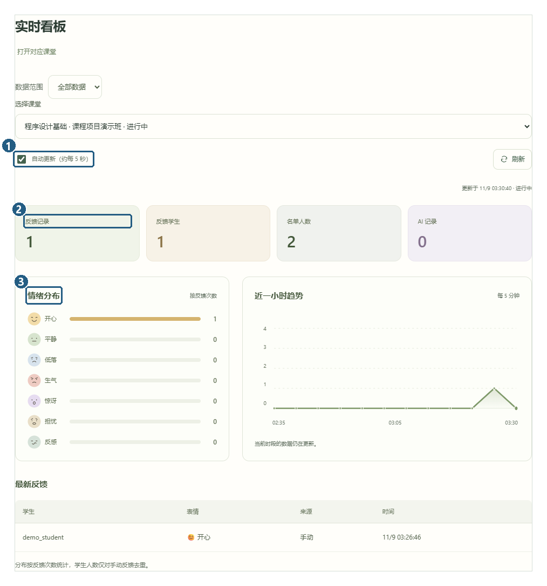

*图 37  实时看板  反馈次数与参与人数分别统计*

[1] 自动更新（约每 5 秒）  [2] 反馈记录  [3] 情绪分布

**操作 1：**进入“实时看板”，选择课堂和数据范围，按需开启自动更新；结果约每 5 秒刷新。

**操作 2：**在“统计与导出”按课程、课堂、班级、时间、来源和汇总粒度查询，确认结果后导出 CSV。

**界面反馈：**看板与报表提供感受分布、次数和趋势；页面隐藏时暂停新轮询，导出使用成功查询的条件。

**实操核对：**本次看板显示已提交的感受；统计页查询后完成了 CSV 实际下载。新修改筛选时会提示重新查询并暂停导出，避免误用旧条件。

**注意事项：**教师仅看本人课程，管理员可查全范围。表情条数、参与学生数和四项评分份数是不同指标，不能混用。

#### 统计查询与 CSV 导出

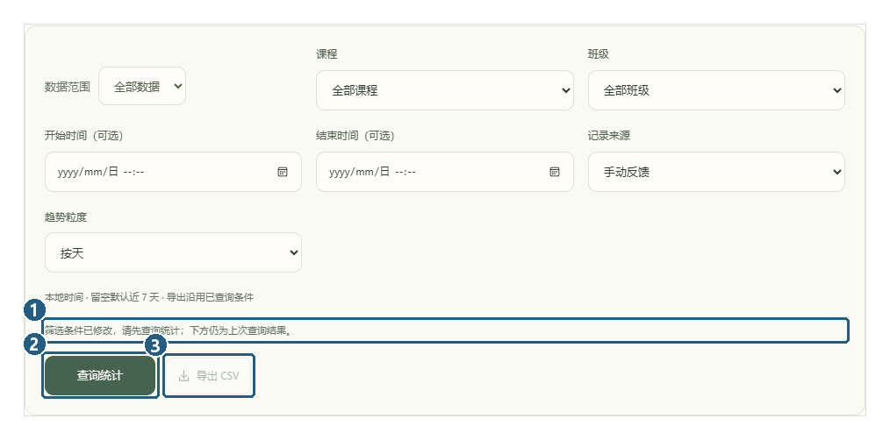

*图 38  筛选改动后  提示重新查询并暂停导出*

[1] 筛选条件已修改，请先查询统计；下方仍为上次查询结果。  [2] 查询统计  [3] 导出 CSV

**操作：**设置课程、班级、时间、来源和粒度，点击“查询统计”。查询成功后图表、汇总和导出使用同一组条件。本次已完成真实 CSV 下载。

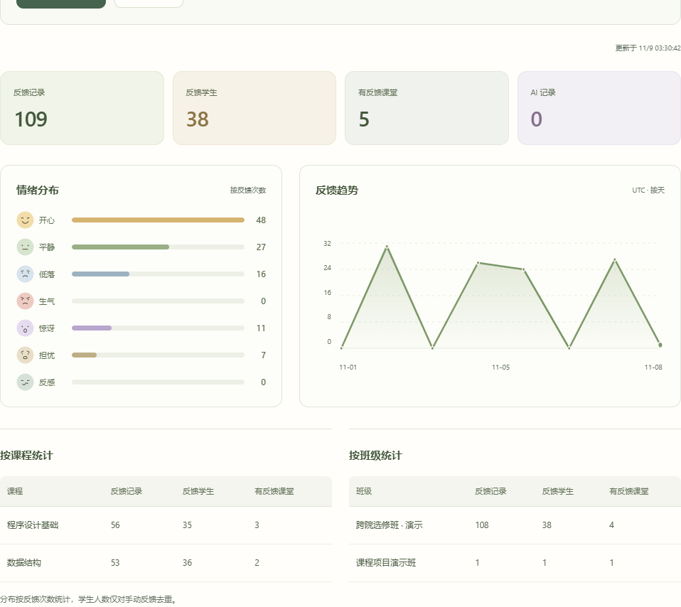

*图 39  按课程与班级汇总的查询结果局部*

**阅读方法：**不要把反馈记录条数当作去重学生人数。AI 匿名记录不能用来确认某名学生的感受；四项评分另在课程评价页面查看。

### 28  结合完整评价写教学反思

**使用场景：**回看学生建议，记录下一次想调整的教学安排。

**入口：**课程评价 → 课后小结 → 保存教学反思

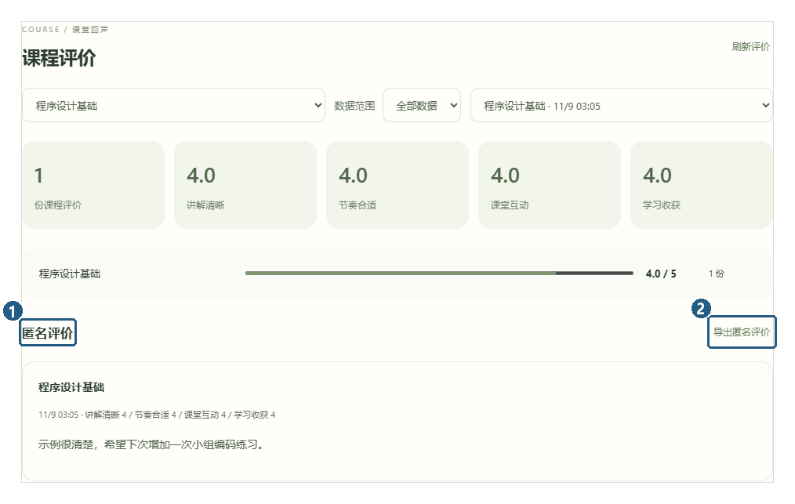

*图 40  教师查看一节课堂的四项均分与匿名建议*

[1] 匿名评价  [2] 导出匿名评价

**操作 1：**在“课程评价”选择课程、课堂和范围，查看四项均分与匿名建议，按需导出。

**操作 2：**打开本节“课后小结”，比较按课堂时间中点分段的反馈，在“教学反思”填写想法并保存，按需导出小结。

**界面反馈：**匿名评价明细不提供学生账号和姓名；保存非空反思后相应待办更新，教学反思最多 2000 字。

**实操核对：**本次查看学生四项评分后，另在已结束课堂填写并保存教学反思；反思与学生私人笔记相互独立。

**注意事项：**反思与学生私人笔记分开保管；需要学生阅读时另行发布学习指引。分布变化不等于教学效果或心理诊断。

#### 保存教师教学反思

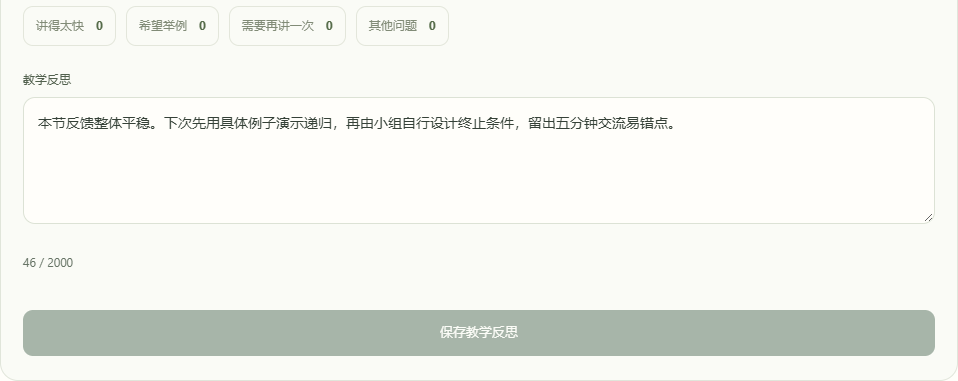

*图 41  已结束课堂的反思区域局部  保存后内容保留*

**操作：**从教学工作台进入已结束课堂的“课后小结”，查看前后半节分布及问题统计，再填写“教学反思”，点击保存。需要整理材料时可导出课堂小结。

**界面反馈：**本例记录了先展示具体递归例子、让小组设计终止条件的后续安排。非空反思保存后，该课堂的待写反思提示更新。

### 29  使用摄像头或 JPEG 表情识别

**使用场景：**在进行中课堂主动尝试识别辅助反馈。

**入口：**课堂表情识别 → 服务就绪 → 开启或上传 → 停止

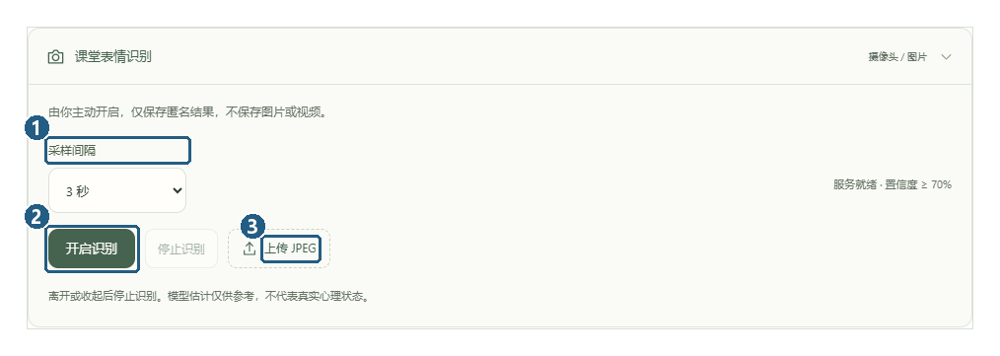

*图 42  真实 AI 服务就绪  摄像头和 JPEG 入口*

[1] 采样间隔  [2] 开启识别  [3] 上传 JPEG

**操作 1：**以教师或管理员身份打开进行中课堂，展开“课堂表情识别”，确认服务就绪，选择 3、5、10 或 30 秒间隔。

**操作 2：**点击“开启识别”，由使用者决定摄像头授权；获得画面后观察结果。也可在停止状态上传不超过 1 MB 的 JPEG。

**操作 3：**结束时点击“停止识别”；收起面板、页面隐藏或离开课堂也会停止采集。

**界面反馈：**页面提供预览及检测、分析、保存、过滤数量。无人脸或置信度不足时可正常过滤，不能要求每帧都有保存结果。

**实操核对：**本次真实服务返回就绪；上传一张无人物的 JPEG 后，页面返回“检测 0 · 分析 0 · 保存 0 · 过滤 0”。这验证了上传和推理响应链路，未验证物理摄像头持续采集或真人表情识别准确率。

**注意事项：**默认不保存图片或视频，只保存匿名结果。结束时停止识别；收起、隐藏或离开页面也会停止采集。模型估计仅供参考，不代表真实心理状态。

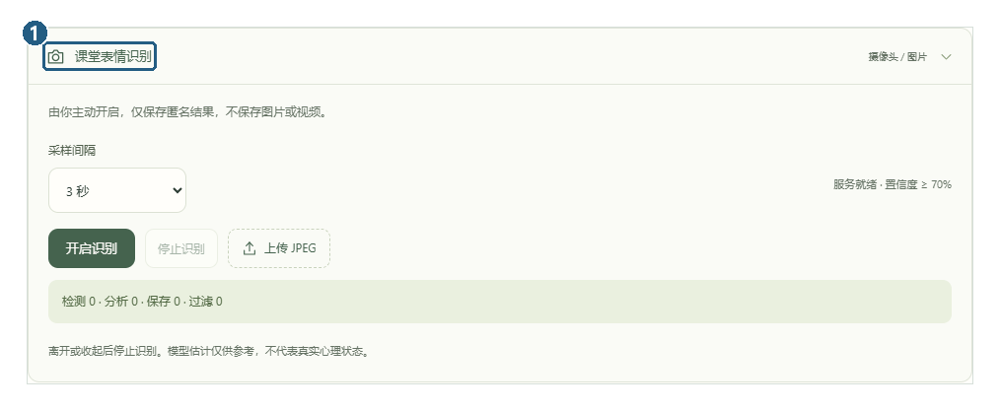

*图 43  上传无脸 JPEG 后真实返回零检测  不代表摄像头验收*

[1] 课堂表情识别

## 管理员：全校开课与维护

### 30  查看全校课表与课程评价

**使用场景：**管理员从一周安排定位到一节课堂的实际反馈。

**入口：**开课总览 → 一周课表或课程与评价 → 展开详情

*图 44  全校开课上部局部  统一院系代表色与筛选*

**操作 1：**按课程、院系或教师关键词，以及院系、课堂状态和数据范围筛选；点击院系颜色图例也可聚焦。

**操作 2：**点击课表中的课堂查看时间、教师、教室和班级，再进入本节评价或统计；切到“课程与评价”可看按课程汇总。

**界面反馈：**课表包含每天及晚间安排，卡片提供表情汇总和独立的多项评分入口；选择的课堂随跳转保留。

**注意事项：**院系使用统一代表色。演示课程参考中国科大学科设置，合成排课、成员与标记评价不属于学校官方课表。

#### 从课表进入具体课堂

*图 45  真实课表下午与晚间局部  每天包含不同课程*

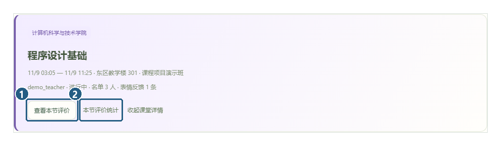

*图 46  点击课堂卡片后展开详情  可进入反馈与统计*

[1] 查看本节评价  [2] 本节评价统计

**操作：**在课表中点击课堂卡片，下方展开任课教师、上课时间、教室、班级和名单人数。核对后进入本节反馈或统计，避免误读相邻日期的课堂。

### 31  维护院系名称和配色

**使用场景：**让课程卡片与课表以统一颜色区分院系。

**入口：**院系与课程维护 → 院系 → 保存资料

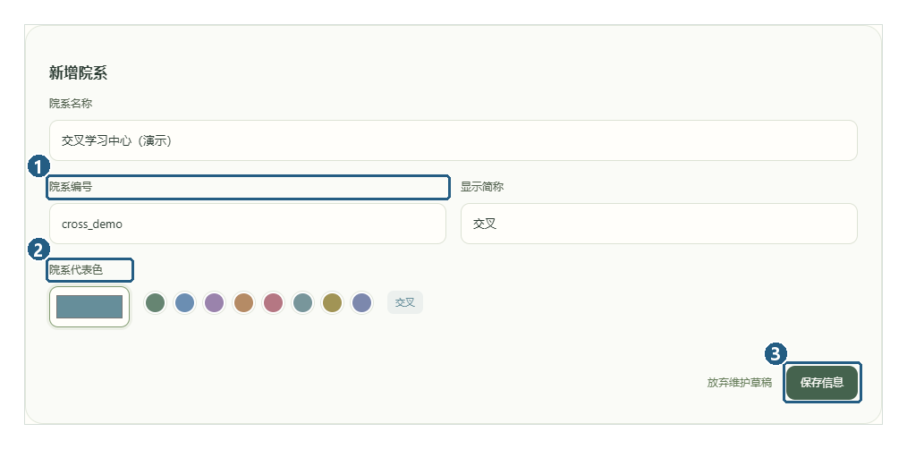

*图 47  新增院系  编号 名称 简称与代表色*

[1] 院系编号  [2] 院系代表色  [3] 保存信息

**操作 1：**切换院系视图，新增或编辑名称、简称与代表色，核对后保存；编号创建后不可修改。

**操作 2：**回到课程卡片与课表刷新，检查同一院系代表色及浅色背景是否一致。

**界面反馈：**背景根据代表色自动生成。版本冲突时保留草稿，需先核对最新资料再重新提交。

**实操核对：**本次新增“交叉学习中心（演示）”，设置简称“交叉”和代表色，保存后可在课程院系选择中使用。

**注意事项：**只有空院系可在二次确认后删除；有课程时先转移课程。删除不可恢复，正式院系无需为了演示随意修改。

### 32  维护课程并归档恢复

**使用场景：**新增课程、调整任课教师，或保留旧课历史。

**入口：**院系与课程维护 → 课程 → 保存或归档恢复

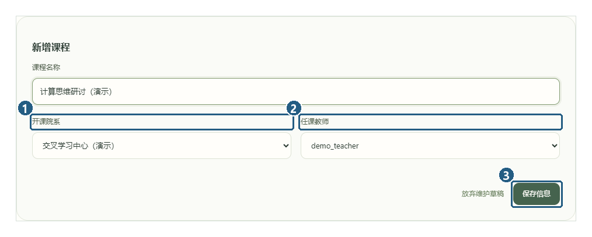

*图 48  管理员新增课程  院系与任课教师*

[1] 开课院系  [2] 任课教师  [3] 保存信息

**操作 1：**新建课程，或编辑已有课程名称、院系及任课教师；教师调整前确认课程和接任人。

**操作 2：**暂时停止新增教学安排时归档课程，恢复使用时选择恢复；通过课程详情核对状态。

**界面反馈：**新教师接管课程的课堂、评价和待审批请假，旧教师失去相应访问权限。归档保留名单与历史，停止新增课堂和加入成员。

**实操核对：**本次新增“计算思维研讨（演示）”，绑定院系和演示教师，并实际完成归档与恢复。

**注意事项：**归档不取消已安排课堂，既有课堂仍按原窗口反馈。原演示标记不能在维护表单中改成普通数据。

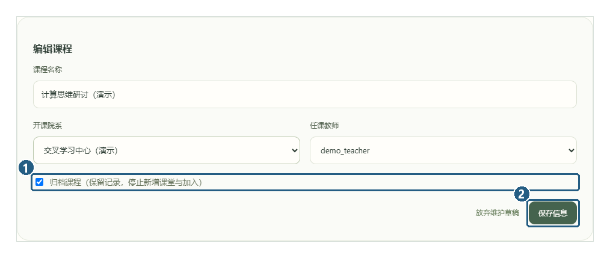

*图 49  勾选归档并保存  恢复时取消勾选*

[1] 归档课程（保留记录，停止新增课堂与加入）  [2] 保存信息

### 33  创建账号并管理课堂名单

**使用场景：**由管理员建立成员入口和具体课堂的学生范围。

**入口：**用户列表或课程与课堂 → 创建账号或保存名单

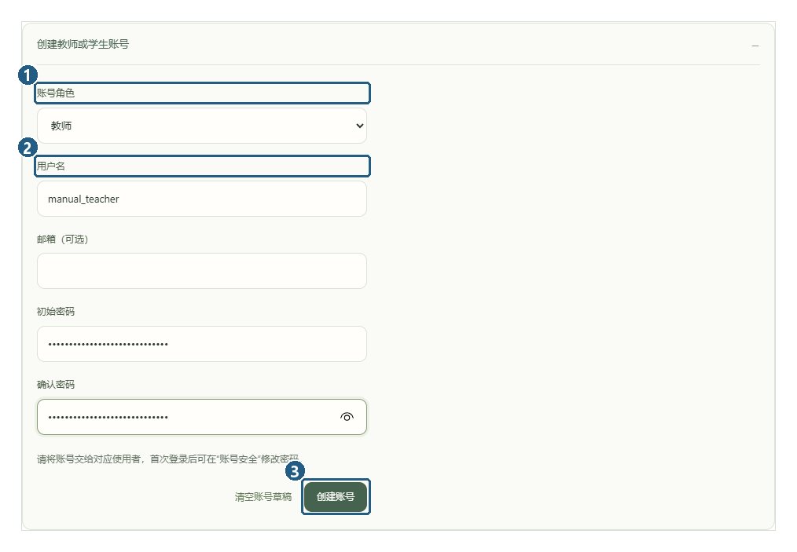

*图 50  管理员创建教师账号  密码不在文档披露*

[1] 账号角色  [2] 用户名  [3] 创建账号

**操作 1：**在“用户列表”展开“创建教师或学生账号”，选择角色并填写用户名、可选邮箱及两次初始密码，提交后核对列表。

**操作 2：**在“课程与课堂”打开目标课堂名单，核对完整学生选择后保存，保留需要参加这节课的成员。

**界面反馈：**名单保存采用整体替换。管理员添加学生也建立课程成员关系；移出单节课堂只影响该节，不等于退出整门课程。

**实操核对：**本次创建 manual_teacher 教师账号成功；账号草稿保护和清空功能亦已验证。管理员名单保存操作返回成功，教师端名单为只读展示。

**注意事项：**普通用户列表提供创建和分页展示。资料编辑、停用和重设密码属于另一个本地开发者成员入口，见场景 35。 本版已补充账号草稿保护：先创建成功，或点击“清空账号草稿”，再切换页面。

#### 管理员调整课堂名单

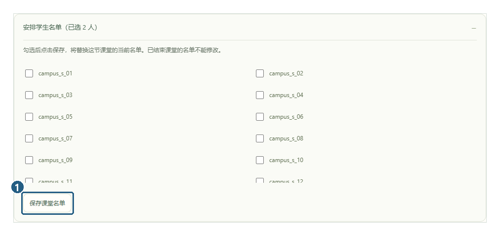

*图 51  名单选择区域  保存时整体替换该节名单*

[1] 保存课堂名单

**操作：**到“课程与课堂”选择尚未结束的目标课堂，在“课堂名单”展开安排入口，核对全部勾选后保存。不要只选新增学生而漏掉原名单。

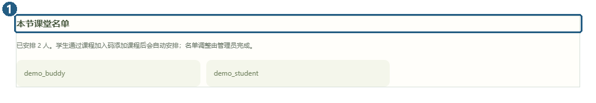

*图 52  教师端名单只读  不提供管理员的勾选工具*

[1] 本节课堂名单

**注意事项：**移出一节课堂不等于退出整门课程。课程后续新建课堂仍按课程成员安排；请假状态与名单是否在册分别处理。

### 34  只读查看请假并筛选演示数据

**使用场景：**全校核查业务记录，答辩时区分合成演示与普通记录。

**入口：**请假记录或数据范围 → 选择条件 → 核对结果

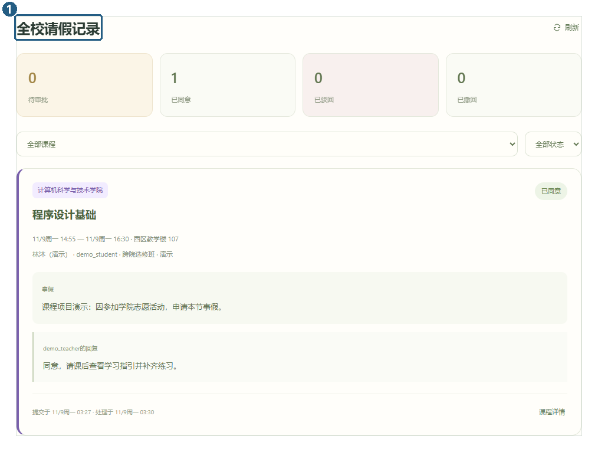

*图 53  管理员只读查看全校请假记录*

[1] 全校请假记录

**操作 1：**在“请假记录”按课程和状态查阅全校申请，审批仍由任课教师负责。

**操作 2：**在提供数据范围的页面选择全部数据、排除演示或仅演示，完成查询或刷新后核对列表、统计与导出条件。

**界面反馈：**课程与课表按课程标记筛选，表情统计按反馈标记，完整评价按评价本身的标记；账号名称不决定数据性质。

**注意事项：**“排除演示”只排除已标记行，不能保证剩余全是真实采集。演示课程中的实际提交也不一定自动标记为演示。

*图 54  按课程标记排除演示  当前筛选无课程时显示空结果*

[1] 数据范围

### 35  管理本地演示成员

**使用场景：**在自己控制的本地演示环境维护其他学生和教师。

**入口：**开发者模式 → 管理学生与教师 → 查找成员

*图 55  本地开发者成员管理  查找 编辑 状态与密码*

[1] 查找成员  [2] 编辑资料  [3] 重设密码  [4] 停用成员

**操作 1：**按用户名、昵称或邮箱查找，并组合角色和状态。新建成员选择学生或教师；编辑资料只修改昵称和邮箱。

**操作 2：**停用或启用须再次确认；重设密码填写两次并确认。操作结束后关闭开发者模式。

**界面反馈：**停用和密码重设使成员原有登录失效，但保留历史数据；启用不会恢复旧登录。固定 demo 账号受保护，管理员不在此管理范围。

**实操核对：**本次对新增演示教师完成昵称修改、停用、启用及密码重设；固定 demo 身份仍保持受保护状态。

**注意事项：**不提供任意成员免密码登录、硬删除或角色转换。模式仅适合本机，不应通过端口转发对外开放。

*图 56  重设密码前再次确认  历史数据保留*

[1] 确认重设密码

## 联合演示路线与本次完善

#### 三人组可按同一课堂连续展示

| 展示者 | 操作顺序 | 接续给谁 |
| --- | --- | --- |
| 学生端 | 添加课程 → 感受与四项评价 → 匿名问题 → 请假 → 笔记与日期回顾 | 教师端处理问题和请假 |
| 教师端 | 回应问题 → 发布指引 → 审批请假 → 看板与统计 → 教学反思 | 学生端核对消息与结果 |
| 管理员端 | 课表定位 → 院系与课程维护 → 创建成员 → 课堂名单 → 数据范围 | 回到学生端核对安排 |

#### 本次发现并已完善

**账号草稿：**管理员创建账号的草稿原先没有接入工作台离开保护，切换页面可能丢失输入。现在未保存时阻止切换和退出，并补充“清空账号草稿”；浏览器关闭提示也已验证。

**统计导出：**统计筛选改变后，原页面未明确提示仍显示旧查询结果。现在显示待查询提示，查询前暂停 CSV 导出；成功查询后恢复导出。

**统计名称：**全校总览与课程卡片中，表情反馈条数原先称“评价”，容易与四项评分混淆。现在数量标签改为“表情反馈”，四项评分仍单独查看。

#### 核验范围与边界

已用独立测试浏览器实际操作三种身份，覆盖注册、加入课程、反馈评分、提问回应、指引发布、请假审批、笔记查询导出、日期详情、头像、学伴留言、排课、院系课程及成员维护。浏览器未捕获页面脚本错误；前端生产构建与两组现有前端检查通过。

AI 服务已启动并完成无脸 JPEG 请求；物理摄像头预览、连续采样、真实人脸识别质量和设备释放仍需在使用者设备上实际验收。不要把本手册的服务就绪图当作硬件通过证明。

说明书截图只反映拍摄时刻。统计会随操作增加，较早截图与后续结果的条数不同属于正常变化。演示数据以本地合成为主，不代表中国科学技术大学官方系统或正式课表。

## 常见情况与处理方法

#### 刚下课为什么还能评价

手动表情和四项评价在结束后 30 分钟内开放。匿名新问题及 AI 识别只在课堂进行中开放，不能把三个窗口混为一谈。

#### 加入课程后为什么仍找不到某节旧课

课程成员与具体课堂名单不同。新加入主要安排未结束课堂，不会自动开放该课程所有历史内容。

#### 曲线的一天为什么与北京时间有差异

个人回顾按 UTC 日期分组，笔记按创建时间归日；请假选日与全校课表使用北京时间，普通课堂多按浏览者本地时间显示。

#### 保存了指引为什么学生仍看到旧版

保存草稿不发布。需正式发布或更新发布，再由学生刷新，并确认读取同一节课堂且仍在实际名单中。

#### 匿名留言为什么不能点击查来源

匿名方式不提供来源接口；只有发布时选择允许查看来源，当前有墙访问权的学生才能点击展开。匿名不等于数据库不可关联。

#### 数据为什么在不同图表中数量不同

先比较数据范围、课堂、起止时间和来源，再区分表情条数、参与学生数与四项评价份数。导出使用已查询条件。

#### 切换页面提示未保存怎么办

先保存，或使用当前表单的取消、撤销或放弃草稿入口。发生冲突时先复制需要的文字，再刷新最新记录，避免强制离开。

#### Windows 相机可用是否证明网页识别通过

不能。网页还需要浏览器授权、进行中课堂、服务就绪、实际预览和推理返回；公开图片处理成功也不能替代硬件采集验收。
